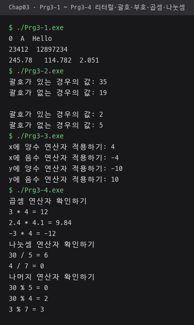
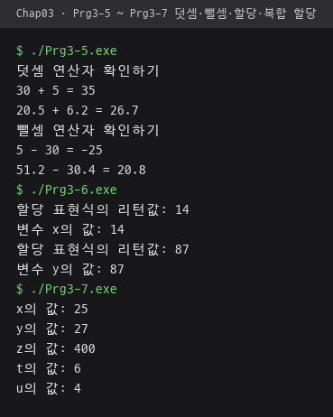
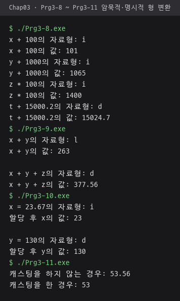
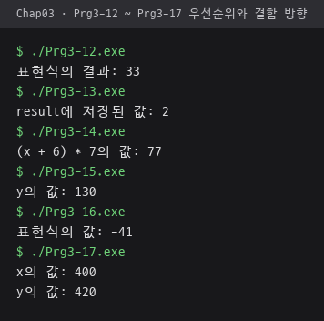
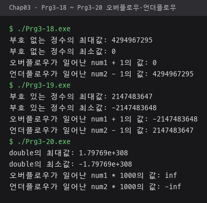
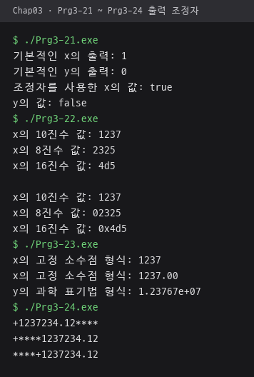
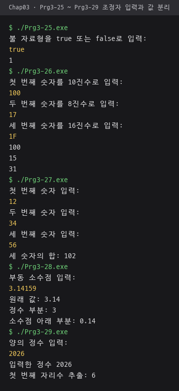
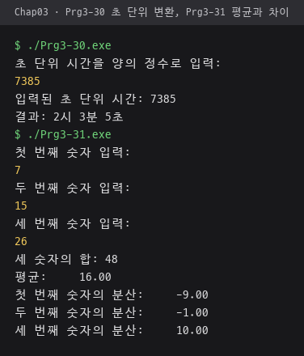
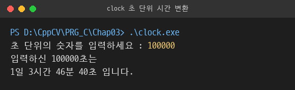

# Chap03 · 표현식과 자료형

리터럴과 연산자 표현식의 평가 순서, 암묵적·명시적 형 변환, 정수·실수 오버플로우, 입출력 조정자 예제와 초 단위 시간 변환 프로그램 구현.

## 다룬 개념

| 개념 | 뜻과 사용 방법 |
|---|---|
| 리터럴 | 코드에 값을 그대로 적은 상수. `false`, `'A'`, `"Hello"`, `12897234L`, `245.78F`처럼 접미사 `L`·`F`로 자료형 지정 |
| 산술 연산자 | 덧셈·뺄셈·곱셈·나눗셈·나머지 연산. 정수끼리 `/`는 몫만 남기고 `%`는 나머지 계산 |
| 단항 연산자 `+`·`-` | 피연산자 하나에 붙는 부호 연산자. `-x`로 부호 반전 |
| 할당·복합 할당 | `=`는 오른쪽 값을 변수에 저장하고 저장한 값을 표현식 결과로 돌려줌. `+=`, `-=`, `*=`, `/=`, `%=`는 연산과 저장을 한 번에 처리 |
| 우선순위와 결합 방향 | 연산자 사이의 계산 순서 규칙. `*`·`/`·`%`가 `+`·`-`보다 먼저, 같은 순위는 왼쪽부터, 할당 연산자는 오른쪽부터 계산. 괄호로 순서 변경 |
| 부가 작용 | 표현식이 값을 만드는 것과 별개로 변수 값을 바꾸는 효과. `y *= x + 5`, `y += x *= 40`처럼 할당이 들어간 표현식 |
| 암묵적 형 변환 | 컴파일러가 자동으로 자료형을 맞추는 변환. `bool`·`char`·`short`는 연산 때 `int`로, `int`와 `double`이 섞이면 `double`로 바뀌고 할당 때는 왼쪽 변수 자료형으로 변환. `typeid(...).name()`으로 결과 자료형 출력 |
| 명시적 형 변환 | 프로그래머가 원하는 자료형을 지정하는 변환. `static_cast<int>(x)`로 소수점 아래 버림, `static_cast<double>(sum)`으로 실수 나눗셈 |
| 오버플로우·언더플로우 | 자료형이 담을 수 있는 범위를 넘는 현상. `numeric_limits<T>::max()`·`min()`으로 범위 끝값을 구한 뒤 1을 더하거나 빼서 범위 밖 값 출력. 부호 없는 정수는 반대쪽 끝값으로 돌아가고 `double`은 무한대 값 |
| 입출력 조정자 | 스트림의 입출력 형식을 바꾸는 명령. `boolalpha`로 `true`·`false` 글자 입출력, `oct`·`hex`·`dec`·`showbase`로 진법 지정, `fixed`·`showpoint`·`setprecision`으로 소수점 자릿수, `setw`·`setfill`·`left`·`internal`·`right`로 폭과 정렬 지정 |
| `/`와 `%`로 단위 분리 | 몫과 나머지를 이어 써서 값을 쪼개는 방법. 초를 일·시·분·초로 나누고 `% 10`으로 일의 자리 추출 |

## 파일별 내용

| 파일 | 내용 | 핵심 코드 |
|---|---|---|
| [Prg3-1.cpp](Prg3-1.cpp) | 불·문자·문자열·정수·실수 리터럴 출력 | `12897234L`, `245.78F`, `2.051L` |
| [Prg3-2.cpp](Prg3-2.cpp) | 괄호 유무에 따른 계산 결과 비교 | `(x + 3) * 5`, `x + 3 * 5` |
| [Prg3-3.cpp](Prg3-3.cpp) | 양수·음수 변수에 단항 부호 연산자 적용 | `+x`, `-y` |
| [Prg3-4.cpp](Prg3-4.cpp) | 곱셈, 정수 나눗셈, 나머지 결과 비교 | `4 / 7`, `30 % 4` |
| [Prg3-5.cpp](Prg3-5.cpp) | 정수·실수 덧셈과 뺄셈 | `20.5 + 6.2`, `5 - 30` |
| [Prg3-6.cpp](Prg3-6.cpp) | 할당 표현식이 돌려주는 값 출력 | `cout << (x = 14)` |
| [Prg3-7.cpp](Prg3-7.cpp) | 복합 할당 연산자 적용 결과 출력 | `x += 5`, `t /= 8`, `u %= 7` |
| [Prg3-8.cpp](Prg3-8.cpp) | `bool`·`char`·`short`·`float`가 연산 중 `int`·`double`로 바뀌는 변환 확인 | `typeid(x + 100).name()` |
| [Prg3-9.cpp](Prg3-9.cpp) | `int`·`long`·`double`이 섞인 표현식의 결과 자료형 확인 | `typeid(x + y + z).name()` |
| [Prg3-10.cpp](Prg3-10.cpp) | 할당 때 왼쪽 변수 자료형으로 바뀌는 변환 확인 | `x = 23.67`, `y = 130` |
| [Prg3-11.cpp](Prg3-11.cpp) | 암묵적 변환과 명시적 변환 결과 비교 | `x + y`, `static_cast<int>(x) + y` |
| [Prg3-12.cpp](Prg3-12.cpp) | `+`와 `*`의 우선순위 확인 | `5 + 7 * 4` |
| [Prg3-13.cpp](Prg3-13.cpp) | `-`와 `%`의 우선순위 확인 | `5 - 15 % 4` |
| [Prg3-14.cpp](Prg3-14.cpp) | 괄호로 덧셈을 먼저 계산 | `(x + 6) * 7` |
| [Prg3-15.cpp](Prg3-15.cpp) | 복합 할당이 들어간 표현식 평가 | `y *= x + 5` |
| [Prg3-16.cpp](Prg3-16.cpp) | 같은 순위 연산자를 왼쪽부터 계산하는 순서 확인 | `5 - 30 / 4 * 8 + 10` |
| [Prg3-17.cpp](Prg3-17.cpp) | 할당 연산자를 오른쪽부터 계산하는 순서 확인 | `y += x *= 40` |
| [Prg3-18.cpp](Prg3-18.cpp) | 부호 없는 정수의 최대값에 1을 더하고 최소값에서 1을 빼는 범위 초과 확인 | `numeric_limits<unsigned int>::max()` |
| [Prg3-19.cpp](Prg3-19.cpp) | 부호 있는 정수의 최대·최소값을 넘기는 연산 | `numeric_limits<int>::min()` |
| [Prg3-20.cpp](Prg3-20.cpp) | `double` 최대값에 곱셈을 적용한 범위 초과 확인 | `numeric_limits<double>::max()`, `num1 *= 1000.00` |
| [Prg3-21.cpp](Prg3-21.cpp) | 불 값을 숫자와 글자로 출력 비교 | `boolalpha` |
| [Prg3-22.cpp](Prg3-22.cpp) | 정수를 10진·8진·16진으로 출력, 진법 접두어 표시 | `oct`, `hex`, `showbase` |
| [Prg3-23.cpp](Prg3-23.cpp) | 실수 기본 출력과 소수점 아래 0 표시 출력 비교 | `showpoint`, `scientific` |
| [Prg3-24.cpp](Prg3-24.cpp) | 소수 둘째 자리 고정, 부호 표시, `*` 채우기와 왼쪽·중간·오른쪽 정렬 비교 | `fixed`, `setprecision(2)`, `showpos`, `setfill('*')`, `setw(15)` |
| [Prg3-25.cpp](Prg3-25.cpp) | `true`·`false` 글자로 불 값 입력 | `cin >> boolalpha >> flag` |
| [Prg3-26.cpp](Prg3-26.cpp) | 10진·8진·16진 정수 입력 | `cin >> oct >> num2`, `cin >> hex >> num3` |
| [Prg3-27.cpp](Prg3-27.cpp) | 정수 세 개를 입력받아 합계 출력 | `sum = first + second + third` |
| [Prg3-28.cpp](Prg3-28.cpp) | 실수를 정수 부분과 소수점 아래 부분으로 분리 | `static_cast<int>(number)`, `number - intPart` |
| [Prg3-29.cpp](Prg3-29.cpp) | 양의 정수의 일의 자리 추출 | `givenInt % 10` |
| [Prg3-30.cpp](Prg3-30.cpp) | 초 단위 시간을 시·분·초로 변환 | `duration / 3600L`, `(duration - (hours * 3600L)) / 60L` |
| [Prg3-31.cpp](Prg3-31.cpp) | 정수 세 개의 합계·평균과 각 값의 평균과의 차이 출력 | `static_cast<double>(sum) / 3`, `setw(9)` |
| [clock.cpp](clock.cpp) | 초 단위 입력을 일·시간·분·초로 변환, 앞 단위의 나머지를 다음 단위 계산에 이어 쓰는 방식 | `times1 / 86400`, `times % 86400`, `times % 3600`, `times % 60` |

## 시간 변환 두 방식 비교

| 구분 | Prg3-30 | clock.cpp |
|---|---|---|
| 나누는 단위 | 시·분·초 | 일·시간·분·초 |
| 남은 초 계산 | 앞 단위 값에 초 수를 곱해 원래 값에서 뺄셈 | `%` 나머지를 다음 단위 계산에 그대로 사용 |

## 실행 결과

MSYS2 g++ 15.2.0으로 컴파일해 실행한 화면. 노란색 줄은 키보드 입력값.

| 리터럴·괄호·부호·곱셈·나눗셈 `Prg3-1`~`Prg3-4` | 덧셈·뺄셈·할당·복합 할당 `Prg3-5`~`Prg3-7` |
|---|---|
|  |  |

| 암묵적·명시적 형 변환 `Prg3-8`~`Prg3-11`. g++의 `typeid` 이름 `i`는 `int`, `l`은 `long`, `d`는 `double` | 우선순위와 결합 방향 `Prg3-12`~`Prg3-17` |
|---|---|
|  |  |

| 오버플로우·언더플로우 `Prg3-18`~`Prg3-20` | 출력 조정자 `Prg3-21`~`Prg3-24` |
|---|---|
|  |  |

| 조정자 입력과 값 분리 `Prg3-25`~`Prg3-29`. `true`, `100`·`17`·`1F`, `12`·`34`·`56`, `3.14159`, `2026` 입력 | 초 단위 변환 `Prg3-30`, 평균과 차이 `Prg3-31`. `7385`, `7`·`15`·`26` 입력 |
|---|---|
|  |  |

`clock.cpp`에 `100000`을 입력한 결과.

