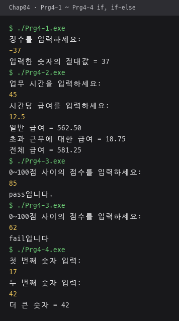
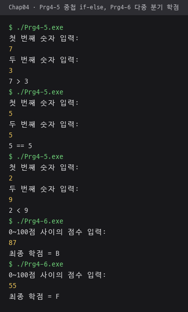
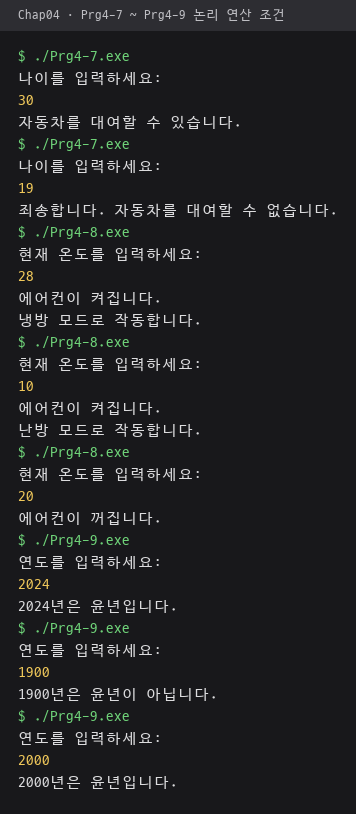
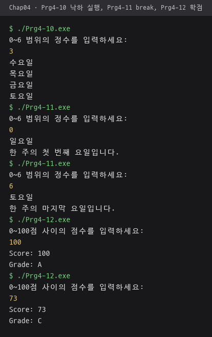
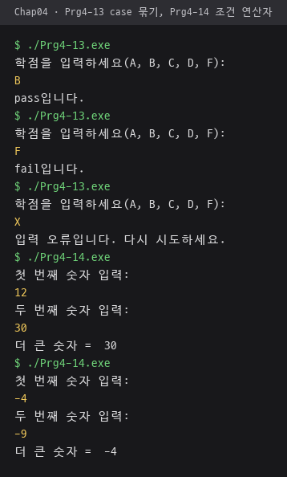
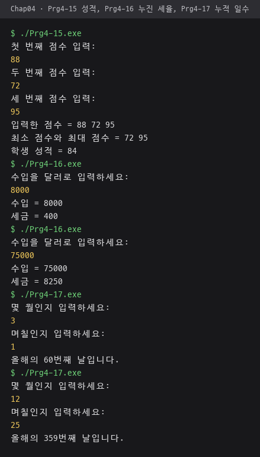

# Chap04 · 선택문

조건에 따라 실행할 문장을 고르는 `if`·`if-else`·`switch`와 조건 연산자, 논리 연산으로 학점·윤년·누진 세금·누적 일수 계산 구현.

## 다룬 개념

| 개념 | 뜻과 사용 방법 |
|---|---|
| `if` | 조건이 참일 때만 블록을 실행하는 문장. 음수일 때만 부호를 바꿔 절대값 계산 |
| `if-else` | 조건의 참·거짓에 따라 두 블록 중 하나를 실행하는 문장. 합격·불합격 판정, 두 수 중 큰 값 선택 |
| 중첩 `if-else` | 조건문 블록 안에 다시 조건문을 두는 구조. 크다·같다·작다 세 경우 구분, 에어컨 가동 여부를 정한 뒤 냉방·난방 선택 |
| 다중 분기 `else if` | 조건을 위에서부터 차례로 검사해 처음 맞는 블록 하나만 실행하는 구조. 점수 구간별 학점, 소득 구간별 세금 |
| 논리 연산자 | `&&`는 둘 다 참, `\|\|`는 하나 이상 참, `!`는 참·거짓 반전. 나이 범위와 윤년 조건을 불 변수에 담아 조건식으로 사용 |
| `switch` | 정수·문자 값과 일치하는 `case`로 이동해 실행하는 문장. 맞는 `case`가 없으면 `default` 실행 |
| `break`와 낙하 실행 | `break`는 `switch`를 빠져나가는 문장. `break`가 없으면 아래 `case`까지 이어서 실행되는 낙하 실행 발생. 여러 `case`가 같은 처리를 공유하거나 값을 차례로 누적할 때 활용 |
| 조건 연산자 `?:` | `조건 ? 값1 : 값2` 형태로 조건에 따라 값 하나를 고르는 표현식. `if-else` 없이 큰 수 선택 |

## 파일별 내용

| 파일 | 내용 | 핵심 코드 |
|---|---|---|
| [Prg4-1.cpp](Prg4-1.cpp) | 입력한 정수의 절대값 출력 | `if(number < 0) number = -number;` |
| [Prg4-2.cpp](Prg4-2.cpp) | 40시간 초과 근무분 수당을 더한 전체 급여 계산 | `if(hours > 40.0)`, `setprecision(2)` |
| [Prg4-3.cpp](Prg4-3.cpp) | 70점 기준 pass·fail 판정 | `if(score >= 70) ... else` |
| [Prg4-4.cpp](Prg4-4.cpp) | 두 수 중 큰 수 선택, 같으면 첫 번째 수 | `if(num1 >= num2)` |
| [Prg4-5.cpp](Prg4-5.cpp) | 중첩 `if-else`로 두 수의 크다·같다·작다 관계 출력 | `if (num1 >= num2)` 안의 `if (num1 > num2)` |
| [Prg4-6.cpp](Prg4-6.cpp) | 점수 구간별 A~F 학점 결정 | `else if(score >= 80)` |
| [Prg4-7.cpp](Prg4-7.cpp) | 25세 이상 100세 이하 자동차 대여 가능 여부 판정 | `eligible = (age >=25) && (age <= 100)` |
| [Prg4-8.cpp](Prg4-8.cpp) | 온도에 따라 에어컨 켜기·끄기와 냉방·난방 모드 선택 | `if(hot \|\| cold)` 안의 `if(hot)` |
| [Prg4-9.cpp](Prg4-9.cpp) | 400·4·100의 배수 조건을 조합한 윤년 판정 | `(divBy400) \|\| (divBy4 && !(divBy100))` |
| [Prg4-10.cpp](Prg4-10.cpp) | `break` 없는 `switch`로 입력한 요일부터 토요일까지 이어서 출력 | `case 0:` ~ `case 6:` |
| [Prg4-11.cpp](Prg4-11.cpp) | `break`로 해당 요일 하나만 출력, 첫날·마지막 날 안내 추가 | `break` |
| [Prg4-12.cpp](Prg4-12.cpp) | 점수를 10으로 나눈 값으로 학점 분기 | `switch(score / 10)`, `default` |
| [Prg4-13.cpp](Prg4-13.cpp) | 여러 `case`를 묶어 학점의 pass·fail 판정, 그 밖의 입력은 오류 안내 | `case 'A': case 'B': case 'C':` |
| [Prg4-14.cpp](Prg4-14.cpp) | 조건 연산자로 큰 수 선택 | `larger = num1 >= num2 ? num1 : num2;` |
| [Prg4-15.cpp](Prg4-15.cpp) | 점수 세 개 중 최대·최소값의 평균을 올림해 성적 산출 | `temp % 2 == 1`, `temp / 2` |
| [Prg4-16.cpp](Prg4-16.cpp) | 소득 구간마다 다른 세율을 누진 적용한 세금 계산 | `bracket1`~`bracket4`, `limit1 * rate1 + (income - limit1) * rate2` |
| [Prg4-17.cpp](Prg4-17.cpp) | 월·일을 입력받아 그해 몇 번째 날인지 계산 | `case 12 : totalDays += m11;` 이후 `break` 없이 누적 |

## `if-else`와 `switch` 비교

| 구분 | `if-else` | `switch` |
|---|---|---|
| 조건 형태 | 범위 비교, 논리식 | 정수·문자 값 일치 |
| 학점 예제 | [Prg4-6.cpp](Prg4-6.cpp), 점수 구간을 `>=`로 비교 | [Prg4-12.cpp](Prg4-12.cpp), `score / 10` 값으로 분기 |
| 여러 경우 묶기 | `\|\|`로 조건 결합 | `break` 없이 `case` 나열 |

## 실행 결과

MSYS2 g++ 15.2.0으로 컴파일해 실행한 화면. 노란색 줄은 키보드 입력값.

| `if`·`if-else` `Prg4-1`~`Prg4-4`. `-37`, `45`·`12.5`, `85`, `62`, `17`·`42` 입력 | 중첩 `if-else` `Prg4-5`, 다중 분기 학점 `Prg4-6`. 세 가지 대소 관계, 점수 `87`·`55` 입력 |
|---|---|
|  |  |

| 논리 연산 조건 `Prg4-7`~`Prg4-9`. 나이 `30`·`19`, 온도 `28`·`10`·`20`, 연도 `2024`·`1900`·`2000` 입력 | `switch` 낙하 실행 `Prg4-10`, `break` `Prg4-11`, 학점 `Prg4-12`. 요일 `3`, `0`·`6`, 점수 `100`·`73` 입력 |
|---|---|
|  |  |

| `case` 묶기 `Prg4-13`, 조건 연산자 `Prg4-14`. 학점 `B`·`F`·`X`, 숫자 `12`·`30`, `-4`·`-9` 입력 | 성적 `Prg4-15`, 누진 세율 `Prg4-16`, 누적 일수 `Prg4-17`. 점수 `88`·`72`·`95`, 수입 `8000`·`75000`, 3월 1일·12월 25일 입력 |
|---|---|
|  |  |
