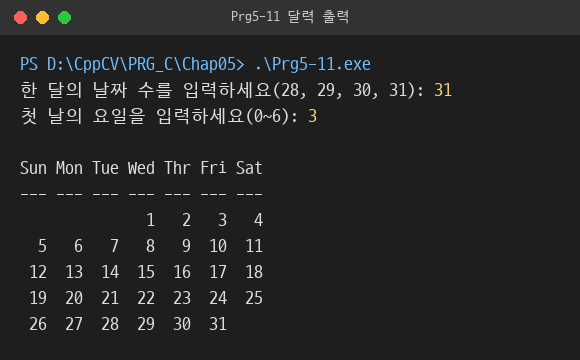

# Chap05 · 반복문

카운터·센티넬·EOF로 끝을 정하는 `while`, 입력 검증용 `do-while`, 중첩 `for`로 합계·달력·곱셈표·소수 판정·팩토리얼·거듭제곱 계산 구현.

## 다룬 개념

| 개념 | 뜻과 사용 방법 |
|---|---|
| `while` | 조건이 참인 동안 블록을 반복하는 문장. 조건을 먼저 검사하므로 처음부터 거짓이면 한 번도 실행되지 않음 |
| 카운터 제어 반복 | 반복 횟수를 세는 변수로 끝을 정하는 방식. `counter`를 늘리며 정해진 횟수만큼 점수 입력 |
| 센티넬 제어 반복 | 데이터로 쓰지 않는 약속된 값이 들어오면 멈추는 방식. `-1` 입력 시 합계 출력 |
| EOF 제어 반복 | 더 읽을 입력이 없을 때 멈추는 방식. `while(cin >> num)`, `while(infile >> num)`처럼 읽기 성공 여부를 조건으로 사용 |
| 파일 입력 `ifstream` | 파일에서 값을 읽는 입력 스트림. `open`으로 파일을 열고 `>>`로 읽은 뒤 `close` |
| 플래그 | 반복 중 조건 충족 여부를 기록하는 불 변수. 찾는 값을 만나면 값을 바꿔 반복 조건에서 종료 |
| `for` | 초기화·조건·증감을 한 줄에 모은 반복문. 횟수가 정해진 반복과 표 형식 출력에 사용 |
| `do-while` | 블록을 먼저 실행한 뒤 조건을 검사해 최소 한 번 실행하는 반복문. 범위를 벗어난 입력을 다시 받는 유효성 검사에 사용 |
| 중첩 반복 | 반복문 안에 반복문을 두는 구조. 바깥 반복은 행, 안쪽 반복은 열을 맡아 별 패턴·숫자 패턴·곱셈표·달력 출력 |
| 반복 중 `return` | 결과가 정해지는 순간 함수를 끝내는 방법. 나누어떨어지는 수를 찾으면 합성수로 출력하고 `main` 종료 |
| 오버플로우 검사 | 곱한 결과가 자료형 범위를 넘었는지 확인하는 방법. 곱셈 결과를 다시 밑으로 나눠 직전 값과 다르면 범위 초과로 판정 |
| 전체 조건과 존재 조건 | 모든 값이 조건을 만족하는지와 하나라도 만족하는지 판정하는 방법. 플래그 초기값과 바꾸는 조건을 서로 반대로 설정 |

## 파일별 내용

| 파일 | 내용 | 핵심 코드 |
|---|---|---|
| [Prg5-1.cpp](Prg5-1.cpp) | 카운터로 같은 메시지 반복 출력 | `while(counter < 10)`, `counter++` |
| [Prg5-2.cpp](Prg5-2.cpp) | 점수 네 개를 입력받아 평균 계산 | `while(counter < 4)`, `static_cast <double>(sum) / 4` |
| [Prg5-3.cpp](Prg5-3.cpp) | `while`로 0부터 n-1까지 출력 | `while(count < n)` |
| [Prg5-4.cpp](Prg5-4.cpp) | 1부터 n까지의 합, 제곱의 합, 세제곱의 합 계산 | `sum2 += counter * counter` |
| [Prg5-5.cpp](Prg5-5.cpp) | `-1`이 들어올 때까지 입력한 수의 합계 | `while(num != -1)` |
| [Prg5-6.cpp](Prg5-6.cpp) | 키보드 입력이 끝날 때까지 입력한 수의 합계 | `while(cin >> num)` |
| [Prg5-7.cpp](Prg5-7.cpp) | `numbers.dat`에 저장된 정수의 합계 | `ifstream infile`, `while (infile >> num)` |
| [Prg5-8.cpp](Prg5-8.cpp) | 파일에서 150 이상인 첫 숫자 탐색, 없으면 안내 출력 | `while(infile >> num && !flag)` |
| [Prg5-9.cpp](Prg5-9.cpp) | `for`로 0부터 n-1까지 출력 | `for(int counter = 0; counter < n; counter++)` |
| [Prg5-10.cpp](Prg5-10.cpp) | 1~300 사이 7의 배수를 한 줄에 10개씩 표 형식으로 출력 | `i % divisor == 0`, `col > 10`, `setw(4)` |
| [Prg5-11.cpp](Prg5-11.cpp) | 한 달의 날짜 수와 첫날 요일을 입력받아 달력 출력 | `do-while` 입력 검증, 앞쪽 여백 `for`, `col > 7`에서 줄바꿈 |
| [Prg5-12.cpp](Prg5-12.cpp) | `do-while`로 정수의 가장 왼쪽 자리 숫자 추출 | `leftDigit = num % 10; num = num / 10;` |
| [Prg5-13.cpp](Prg5-13.cpp) | 0~100 범위의 점수만 받아 학점 출력 | `do { ... } while(score < 0 \|\| score > 100);` |
| [Prg5-14.cpp](Prg5-14.cpp) | 입력한 행·열 수만큼 `*` 사각형 출력 | 중첩 `for`, `cout << "*"` |
| [Prg5-15.cpp](Prg5-15.cpp) | 행마다 시작 숫자가 1씩 커지는 숫자 패턴 출력 | `for(int j = i; j <= i + cols -1; j++)` |
| [Prg5-16.cpp](Prg5-16.cpp) | 입력한 크기의 곱셈표 출력 | `setw(4) << i * j` |
| [Prg5-17.cpp](Prg5-17.cpp) | 1·합성수·소수 판정, 결과가 정해지면 즉시 종료 | `if(num % i == 0) { ... return 0; }` |
| [Prg5-18.cpp](Prg5-18.cpp) | 개수를 먼저 정한 숫자 목록의 합과 곱 | `long double`, `product *= number` |
| [Prg5-19.cpp](Prg5-19.cpp) | 팩토리얼 계산 | `unsigned long long factorial`, `factorial *= i` |
| [Prg5-20.cpp](Prg5-20.cpp) | 반복 곱셈으로 거듭제곱 계산, 범위를 넘으면 반복 종료 | `if(power / base != temp)`, `(i <= exponent) && (!overflow)` |
| [Prg5-21.cpp](Prg5-21.cpp) | 숫자 목록의 최소값과 최대값 | `smallest = numeric_limits<int>::max()` |
| [Prg5-22.cpp](Prg5-22.cpp) | 목록에 7로 나누어떨어지는 수가 있는지 확인, 찾으면 반복 종료 | `(i < size ) && (!success)`, `item % 7 == 0` |
| [all.cpp](all.cpp) | 입력한 수가 모두 양수인지 판정 | `bool success = true`, `if (x <= 0) success = false;` |
| [any.cpp](any.cpp) | 입력한 수 중 양수가 하나라도 있는지 판정 | `bool success = false`, `if (x > 0) success = true;` |
| [homework.cpp](homework.cpp) | `any.cpp`와 `all.cpp` 코드를 한 파일에 이어 붙인 과제 파일. `main` 함수가 두 개라 컴파일은 `any.cpp`·`all.cpp`로 따로 진행 | 플래그 초기값 `false`·`true` |

`numbers.dat`: `Prg5-7`, `Prg5-8`이 읽는 정수 목록.

## all과 any 비교

| 구분 | all.cpp | any.cpp |
|---|---|---|
| 판정 | 모든 값이 양수 | 양수가 하나 이상 |
| 플래그 초기값 | `true` | `false` |
| 플래그를 바꾸는 조건 | `x <= 0`이면 `false` | `x > 0`이면 `true` |

## 실행 결과

`Prg5-11.cpp`에 날짜 수 `31`, 첫날 요일 `3`을 입력한 결과.

