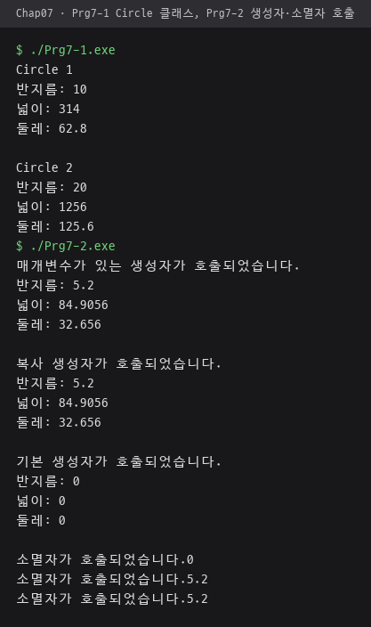
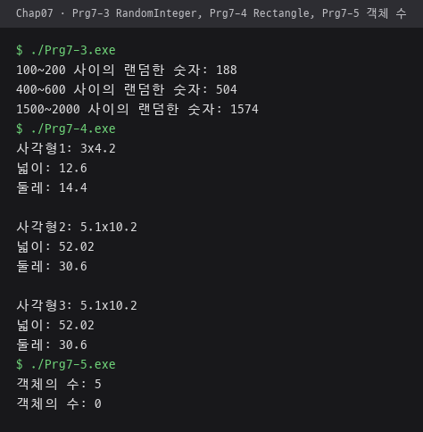
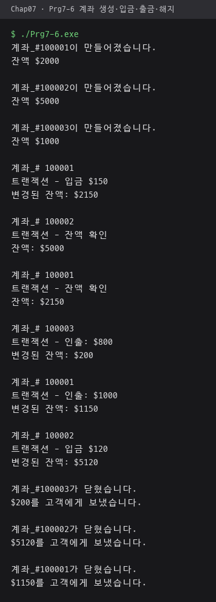
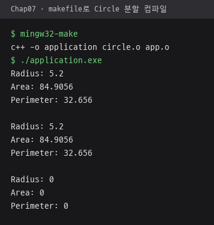
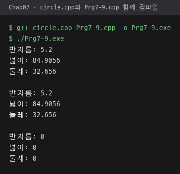
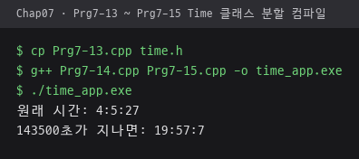
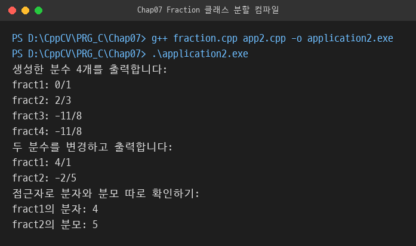

# Chap07 · 클래스

데이터와 함수를 묶는 클래스로 Circle·RandomInteger·Rectangle·Account·Fraction·Time 객체 구현, 헤더·구현·애플리케이션 파일 분리와 makefile 분할 컴파일 구성.

## 다룬 개념

| 개념 | 뜻과 사용 방법 |
|---|---|
| 클래스와 객체 | 클래스는 데이터 멤버와 멤버 함수를 묶은 설계도, 객체는 클래스로 만든 실제 값. `Circle circle1;`로 객체를 만들고 `circle1.setRadius(10.0)`처럼 멤버 함수 호출 |
| 접근 지정자 | `private` 멤버는 클래스 안에서만, `public` 멤버는 클래스 밖에서도 사용. 반지름·잔액 같은 데이터는 `private`, 조회·변경 함수는 `public` |
| 접근자·설정자 | 접근자는 데이터를 읽기만 하는 멤버 함수로 `const`를 붙여 객체 변경을 막고, 설정자는 데이터를 바꾸는 멤버 함수 |
| 생성자와 초기화 목록 | 생성자는 객체가 만들어질 때 자동 호출되는 함수. 매개변수 생성자, 기본 생성자로 나누고 `: radius(rds)` 같은 초기화 목록으로 데이터 멤버 초기화 |
| 복사 생성자 | 같은 클래스의 다른 객체를 받아 같은 값으로 새 객체를 만드는 생성자. `Circle circle2(circle1);`로 호출, `= delete`로 복사 금지 지정 |
| 소멸자 | 객체가 사라질 때 자동 호출되는 `~클래스명` 함수. 소멸 시점 메시지 출력, 객체 수 감소, 계좌 해지 안내에 사용 |
| `static` 멤버 | 객체마다 따로 있지 않고 클래스 전체가 하나를 공유하는 멤버. 생성자에서 늘리고 소멸자에서 줄여 현재 객체 수 관리, 계좌 번호 발급 |
| `assert`와 불변 조건 | 불변 조건은 객체가 항상 지켜야 할 값의 조건, `assert`는 조건이 거짓이면 프로그램을 멈추는 검사. 음수 반지름·길이, 분모 0, 음수 잔액, 음수 시간 거부 |
| private 보조 함수 | 클래스 내부에서만 쓰는 도우미 멤버 함수. `normalize`로 분수 약분과 부호 정리, 시간 자리올림 |
| 파일 분리 | 클래스 선언은 인터페이스 파일 `.h`, 멤버 함수 정의는 구현 파일 `.cpp`, 객체를 쓰는 `main`은 애플리케이션 파일 `.cpp`에 두는 구조. `#ifndef`·`#define`·`#endif` 헤더 가드로 중복 포함 방지 |
| makefile 분할 컴파일 | 소스 파일을 각각 목적 파일로 컴파일한 뒤 묶어 실행 파일을 만드는 빌드 규칙. `%.o: %.cpp` 패턴 규칙과 `$@`·`$^`·`$<` 자동 변수 사용 |

## 파일별 내용

| 파일 | 내용 | 핵심 코드 |
|---|---|---|
| [Prg7-1.cpp](Prg7-1.cpp) | 반지름 설정·조회와 넓이·둘레 계산을 가진 Circle 클래스, 객체 두 개 생성 | `class Circle`, `double getArea() const` |
| [Prg7-2.cpp](Prg7-2.cpp) | 매개변수·기본·복사 생성자와 소멸자의 호출 시점을 메시지로 확인 | `Circle(const Circle& circle)`, `~Circle()` |
| [Prg7-3.cpp](Prg7-3.cpp) | 생성할 때 범위 안 난수를 정하는 RandomInteger 클래스 | `:low(lw), high(hh)`, `RandomInteger(const RandomInteger& random) = delete;` |
| [Prg7-4.cpp](Prg7-4.cpp) | 길이나 높이가 0 이하이면 생성을 멈추는 Rectangle 클래스 | `assert(false)`, 복사 생성자 |
| [Prg7-5.cpp](Prg7-5.cpp) | 정적 데이터 멤버로 살아 있는 Rectangle 객체 수 계산, 블록을 벗어나면 줄어드는 수 출력 | `static int count;`, `static int getCount();` |
| [Prg7-6.cpp](Prg7-6.cpp) | 계좌 생성·입금·출금·잔액 조회, 정적 멤버로 계좌 번호 발급 | `static int base;`, `accNumber = 100000 + base;` |
| [Prg7-7.cpp](Prg7-7.cpp) | Circle 클래스 선언 코드, `circle.h`와 같은 내용 | `#ifndef CIRCLE_H` |
| [Prg7-8.cpp](Prg7-8.cpp) | Circle 멤버 함수 정의 코드, `circle.cpp`와 같은 내용 | `# include "circle.h"`, `assert(false)` |
| [Prg7-9.cpp](Prg7-9.cpp) | Circle 객체를 만드는 애플리케이션 코드, `app.cpp`와 같은 흐름에 출력 문구만 한글 | `Circle circle2(circle1);` |
| [Prg7-10.cpp](Prg7-10.cpp) | Fraction 클래스 선언 코드, 기본 인수 없는 선언 | `void normalize();`, `int gcd(int n, int m);` |
| [Prg7-11.cpp](Prg7-11.cpp) | Fraction 멤버 함수 정의 코드, 정의 쪽에 기본 인수 `den = 1` | `Fraction::Fraction(int num, int den = 1)` |
| [Prg7-12.cpp](Prg7-12.cpp) | Fraction 객체 생성·변경·조회 애플리케이션 코드, `app2.cpp`와 같은 내용 | `fract2.setDenom(-5);` |
| [Prg7-13.cpp](Prg7-13.cpp) | 시·분·초를 가진 Time 클래스 선언 코드, `time.h` 내용 | `void tick();`, `void normalize();` |
| [Prg7-14.cpp](Prg7-14.cpp) | Time 멤버 함수 정의 코드, 60초·60분·24시 자리올림 | `seconds = seconds % 60;`, `hours = hours % 24;` |
| [Prg7-15.cpp](Prg7-15.cpp) | 1초씩 더하는 `tick`을 반복 호출해 143500초 뒤 시간 출력하는 애플리케이션 코드 | `time.tick();` 반복 |
| [circle.h](circle.h) | Circle 클래스 선언, 헤더 가드 | `#ifndef CIRCLE_H`, `#define CIRCLE_H` |
| [circle.cpp](circle.cpp) | Circle 멤버 함수 정의, 음수 반지름 거부 | `if (radius < 0.0) assert(false);` |
| [app.cpp](app.cpp) | 매개변수·복사·기본 생성자로 Circle 객체를 만들고 반지름·넓이·둘레 출력 | `Circle circle1(5.2);`, `Circle circle3;` |
| [fraction.h](fraction.h) | Fraction 클래스 선언, 분모 기본 인수 1 | `Fraction(int num, int den = 1);` |
| [fraction.cpp](fraction.cpp) | 생성·설정 때마다 분모 0 검사, 음수 부호를 분자로 옮기고 최대공약수로 약분 | `normalize()`, `gcd(abs(numer), abs(denom))` |
| [app2.cpp](app2.cpp) | 분수 생성·복사, 분자·분모 변경 후 약분 결과와 접근자 값 출력 | `Fraction fract3(11, -8);`, `setNumer`, `getDenom` |
| [makefile](makefile) | `circle.cpp`와 `app.cpp`를 목적 파일로 컴파일해 `application` 생성, `clean` 규칙 | `OBJECTS = $(SOURCES:.cpp=.o)`, `%.o: %.cpp` |

## 분할 컴파일 구성

| 클래스 | 인터페이스 | 구현 | 애플리케이션 | 빌드 |
|---|---|---|---|---|
| Circle | [circle.h](circle.h) | [circle.cpp](circle.cpp) | [app.cpp](app.cpp) | `make` 또는 `mingw32-make` |
| Fraction | [fraction.h](fraction.h) | [fraction.cpp](fraction.cpp) | [app2.cpp](app2.cpp) | `g++ fraction.cpp app2.cpp -o application2.exe` |
| Time | [Prg7-13.cpp](Prg7-13.cpp) | [Prg7-14.cpp](Prg7-14.cpp) | [Prg7-15.cpp](Prg7-15.cpp) | 포함하는 `time.h`가 폴더에 없는 번호 파일 구성 |

- `Prg7-7`~`Prg7-12`는 위 Circle·Fraction 파일과 같은 코드를 번호 파일로 둔 것. `circle.h`·`circle.cpp`는 들여쓰기만 다르고, `app.cpp`는 출력 문구를 영어로 바꾼 판.
- `fraction.h`는 분모 기본 인수 `den = 1`을 선언 쪽으로 옮긴 판, `fraction.cpp`는 정의 쪽 기본 인수를 뺀 판.

## 실행 결과

MSYS2 g++ 15.2.0으로 컴파일해 실행한 화면.

| Circle 클래스 `Prg7-1`, 생성자·소멸자 호출 순서 `Prg7-2` | RandomInteger `Prg7-3`, Rectangle `Prg7-4`, 정적 멤버 객체 수 `Prg7-5` |
|---|---|
|  |  |

| 계좌 생성·입금·출금·해지 `Prg7-6` | `mingw32-make`로 `circle.cpp`·`app.cpp` 분할 컴파일 후 실행 |
|---|---|
|  |  |

| `circle.cpp`와 `Prg7-9.cpp`를 함께 컴파일한 한글 출력판 | `Prg7-13.cpp`를 `time.h` 이름으로 복사해 `Prg7-14`·`Prg7-15`와 함께 빌드한 결과 |
|---|---|
|  |  |

`fraction.cpp`와 `app2.cpp`를 함께 컴파일한 결과. `14/21`은 `2/3`, `11/-8`은 `-11/8`로 정리.

