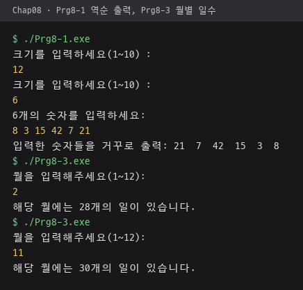
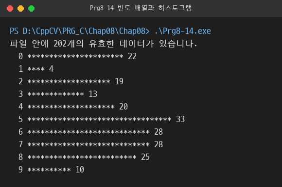

# Chap08 · 배열 예제 소스

8장 배열 예제의 `.cpp` 소스와 예제가 읽는 데이터 파일 폴더. 개념 설명, 핵심 코드, 선형 변환 비교, 실행 결과는 상위 폴더 [Chap08 README](../README.md)에 정리.

## 소스 파일

| 파일 | 역할 |
|---|---|
| [Prg8-1.cpp](Prg8-1.cpp) | 입력한 정수 목록을 배열에 저장해 역순 출력 |
| [Prg8-2.cpp](Prg8-2.cpp) | `inFile.dat` 정수를 배열로 읽어 역순으로 `outFile.dat`에 저장 |
| [Prg8-3.cpp](Prg8-3.cpp) | 월을 인덱스로 써서 그달의 일수 출력 |
| [Prg8-4.cpp](Prg8-4.cpp) | Circle 객체 배열의 반지름·넓이·둘레 출력. 포함하는 `circle.h`는 [`../../Chap07`](../../Chap07) 폴더에 위치 |
| [Prg8-5.cpp](Prg8-5.cpp) | `numFile.dat` 정수로 합계·평균·최소값·최대값 계산 |
| [Prg8-6.cpp](Prg8-6.cpp) | 배열과 크기를 받아 원소를 출력하는 `print` 함수 |
| [Prg8-7.cpp](Prg8-7.cpp) | 배열 원소를 두 배로 바꾸는 `multiplyByTwo` 함수 |
| [Prg8-8.cpp](Prg8-8.cpp) | 첫 배열을 뒤집어 두 번째 배열에 담는 `reverse` 함수 |
| [Prg8-9.cpp](Prg8-9.cpp) | 이름·점수·학점 병렬 배열로 학점 생성 |
| [Prg8-10.cpp](Prg8-10.cpp) | Student 클래스 인터페이스, `student.h` 내용 |
| [Prg8-11.cpp](Prg8-11.cpp) | Student 클래스 구현 코드 |
| [Prg8-12.cpp](Prg8-12.cpp) | Student 객체 배열 생성과 출력 애플리케이션 코드 |
| [Prg8-13.cpp](Prg8-13.cpp) | 2차원 점수 배열로 학생 평균과 시험 평균 계산 |
| [Prg8-14.cpp](Prg8-14.cpp) | `integerFile.dat`의 0~9 정수 빈도를 세어 `*` 히스토그램 출력 |
| [Prg8-15.cpp](Prg8-15.cpp) | 2행 4열 배열을 행 방향·열 방향 1차원 배열로 변환 |

## 데이터 파일

| 파일 | 역할 |
|---|---|
| `inFile.dat` | `Prg8-2` 입력 정수 10개 |
| `numFile.dat` | `Prg8-5` 입력 정수 10개 |
| `integerFile.dat` | `Prg8-14` 입력 정수 목록. 0~9 범위 밖 값 13·15·17 일부 포함 |

## 빌드·실행 방법

MSYS2 MinGW-w64 g++ 기준. 데이터 파일을 상대 경로로 읽으므로 이 폴더에서 실행.

```bash
cd PRG_C/Chap08/Chap08
g++ Prg8-14.cpp -o Prg8-14.exe
./Prg8-14.exe
```

- `Prg8-4`: `circle.h`가 이 폴더에 없어 단독 컴파일 불가.
- `Prg8-10`~`Prg8-12`: `student.h`, 구현 파일, 애플리케이션 파일로 나눠 저장해야 컴파일되는 코드 조각.

## 실행 결과

이 폴더 소스를 MSYS2 g++ 15.2.0으로 컴파일해 실행한 화면 중 일부. 나머지 결과는 [상위 README](../README.md#실행-결과)에 정리.

| 역순 출력 `Prg8-1`, 월별 일수 `Prg8-3`. 크기 `12` 다음 `6`, 정수 6개, 월 `2`·`11` 입력 | `integerFile.dat` 빈도 히스토그램 `Prg8-14` |
|---|---|
|  |  |
