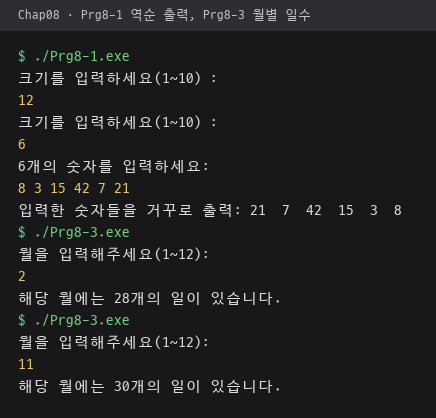
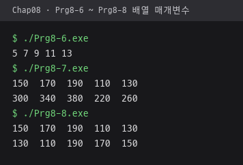
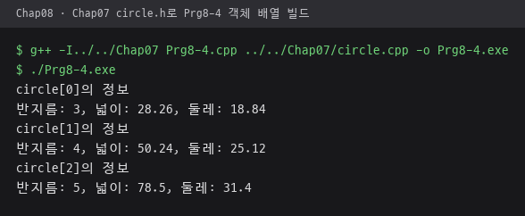
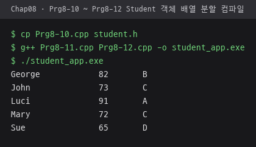
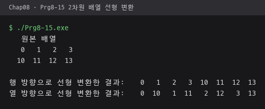
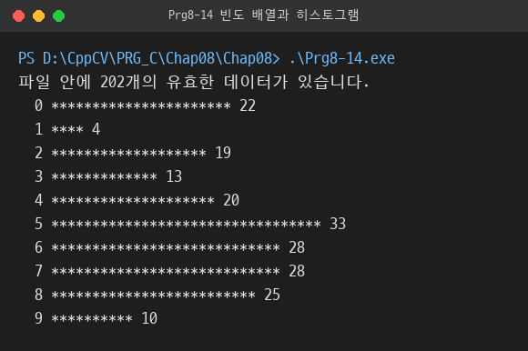
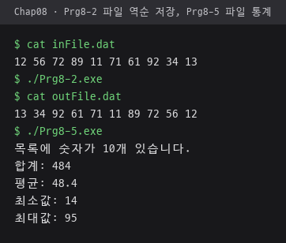
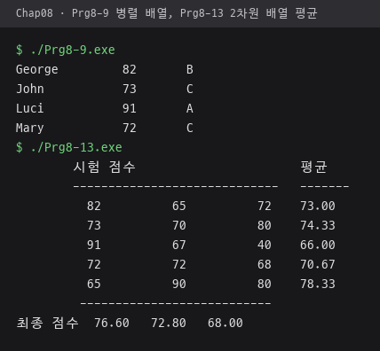

# Chap08 · 배열

같은 자료형 값을 연속으로 저장하는 배열로 역순 출력, 파일 입출력, 객체 배열, 병렬 배열, 2차원 배열 평균, 빈도 히스토그램, 2차원 배열의 1차원 변환 구현.

소스와 데이터 파일 위치는 하위 폴더 [`Chap08/`](Chap08).

## 다룬 개념

| 개념 | 뜻과 사용 방법 |
|---|---|
| 배열 | 같은 자료형 값을 연속된 메모리에 저장하고 0부터 시작하는 인덱스로 접근하는 자료 구조. `const int CAPACITY = 10;`으로 최대 크기를 상수로 정하고 실제 사용 개수 `size`를 따로 관리 |
| 배열 초기화 | 선언할 때 중괄호로 값을 채우는 방법. 적은 값보다 뒤쪽 칸은 0으로 채워짐. 월별 일수 표 `{0, 31, 28, ...}`, 빈도 배열 `{0}` |
| 파일 입출력 | `ifstream`으로 파일에서 읽고 `ofstream`으로 파일에 쓰는 스트림. `if(!inputFile)`로 열기 실패 처리 |
| 객체 배열 | 클래스 객체를 원소로 갖는 배열. 기본 생성자로 배열을 만든 뒤 `circles[0] = Circle(3.0);`처럼 객체 대입 |
| 배열 매개변수 | 함수에 배열 이름과 크기를 함께 넘기는 방법. 배열은 복사되지 않고 원본이 전달되므로 읽기만 하는 함수에는 `const` 지정, 결과 배열을 매개변수로 받아 값을 채워 돌려주는 유사 반환 |
| 병렬 배열 | 같은 인덱스가 같은 대상을 가리키는 여러 배열. 이름·점수·학점 배열을 인덱스로 연결 |
| 2차원 배열 | 행과 열로 이루어진 배열. 매개변수에 열 크기를 적어 `scores[][3]`로 받고, 행 방향 합으로 학생 평균, 열 방향 합으로 시험 평균 계산 |
| 빈도 배열과 히스토그램 | 값 자체를 인덱스로 써서 등장 횟수를 세는 배열. `frequencies[data]++`로 센 뒤 횟수만큼 `*` 출력 |
| 선형 변환 | 2차원 배열을 1차원 배열로 펼치는 방법. 행 방향은 한 행씩, 열 방향은 한 열씩 차례로 복사 |

## 파일별 내용

| 파일 | 내용 | 핵심 코드 |
|---|---|---|
| [Prg8-1.cpp](Chap08/Prg8-1.cpp) | 입력한 정수 목록을 배열에 저장해 역순 출력 | `int numbers[CAPACITY];`, `for(int i = size - 1; i >= 0; i--)` |
| [Prg8-2.cpp](Chap08/Prg8-2.cpp) | `inFile.dat`의 정수를 배열로 읽어 역순으로 `outFile.dat`에 저장 | `ifstream`, `ofstream`, `if(!inputFile)` |
| [Prg8-3.cpp](Chap08/Prg8-3.cpp) | 월을 인덱스로 써서 그달의 일수 출력 | `numberOfDays[13]`, `numberOfDays[month]` |
| [Prg8-4.cpp](Chap08/Prg8-4.cpp) | Circle 객체 배열을 만들고 반지름·넓이·둘레 출력. 포함하는 `circle.h`는 [`../Chap07`](../Chap07) 폴더에 있는 구성 | `Circle circles[3];`, `circles[0] = Circle(3.0);` |
| [Prg8-5.cpp](Chap08/Prg8-5.cpp) | `numFile.dat`의 정수로 합계·평균·최소값·최대값 계산 | `while(inputFile >> numbers[size])` |
| [Prg8-6.cpp](Chap08/Prg8-6.cpp) | 배열과 크기를 받아 원소를 출력하는 함수 | `void print(const int numbers[], int size)` |
| [Prg8-7.cpp](Chap08/Prg8-7.cpp) | 배열 원소를 두 배로 바꾸는 함수, 변경 전후 출력 | `void multiplyByTwo(int numbers[], int size)` |
| [Prg8-8.cpp](Chap08/Prg8-8.cpp) | 첫 배열을 뒤집어 두 번째 배열에 담는 함수 | `void reverse(const int array1[], int array2[], int size)` |
| [Prg8-9.cpp](Chap08/Prg8-9.cpp) | 이름·점수·학점 병렬 배열, 점수 배열로 학점 배열 생성 | `grades[i] = temp[scores[i]/10];`, `setw(10) << left` |
| [Prg8-10.cpp](Chap08/Prg8-10.cpp) | Student 클래스 선언 코드, `student.h` 내용 | `class Student`, `#ifndef STUDENT_H` |
| [Prg8-11.cpp](Chap08/Prg8-11.cpp) | Student 생성자에서 점수로 학점 결정, 이름·점수·학점 정렬 출력 함수 정의 코드 | `grade = temp[score /10];`, `setw(12) << left` |
| [Prg8-12.cpp](Chap08/Prg8-12.cpp) | Student 객체 배열을 만들고 이름·점수·학점 출력하는 애플리케이션 코드 | `Student students[5];`, `students[0] = Student("George", 82);` |
| [Prg8-13.cpp](Chap08/Prg8-13.cpp) | 학생별 시험 점수 2차원 배열에서 학생 평균과 시험 평균 계산 | `findStudentAverage`, `findTestAverage`, `int const scores[][3]` |
| [Prg8-14.cpp](Chap08/Prg8-14.cpp) | `integerFile.dat`에서 0~9 정수의 빈도를 세고 `*` 히스토그램 출력 | `frequencies[data]++`, `if(data >= 0 && data <= 9)` |
| [Prg8-15.cpp](Chap08/Prg8-15.cpp) | 2행 4열 배열을 행 방향·열 방향 1차원 배열로 변환 | `rowTransform`, `colTransform`, `const int originArray [][4]` |

`inFile.dat`, `numFile.dat`, `integerFile.dat`: 차례로 `Prg8-2`, `Prg8-5`, `Prg8-14`가 읽는 정수 목록.

`Prg8-10`~`Prg8-12`는 인터페이스 파일 `student.h`와 구현·애플리케이션 파일로 나눠 저장해야 컴파일되는 코드 조각.

## 선형 변환 결과 비교

`Prg8-15.cpp`의 원본 배열 `{{0, 1, 2, 3}, {10, 11, 12, 13}}` 기준.

| 방식 | 복사 순서 | 결과 |
|---|---|---|
| 행 방향 | 0행 전체 다음 1행 전체 | `0 1 2 3 10 11 12 13` |
| 열 방향 | 0열 위아래 다음 1열 위아래 | `0 10 1 11 2 12 3 13` |

## 실행 결과

MSYS2 g++ 15.2.0으로 컴파일해 실행한 화면. 노란색 줄은 키보드 입력값.

| 역순 출력 `Prg8-1`, 월별 일수 `Prg8-3`. 크기 `12` 다음 `6`, 정수 6개, 월 `2`·`11` 입력 | 배열 매개변수 `Prg8-6`~`Prg8-8` |
|---|---|
|  |  |

| `Chap07`의 `circle.h`·`circle.cpp`로 빌드한 Circle 객체 배열 `Prg8-4` | `Prg8-10.cpp`를 `student.h` 이름으로 복사해 `Prg8-11`·`Prg8-12`와 함께 빌드한 Student 객체 배열 |
|---|---|
|  |  |

| 2차원 배열 선형 변환 `Prg8-15` | `Prg8-14.cpp`가 `integerFile.dat`에서 0~9 정수만 세어 출력한 히스토그램 |
|---|---|
|  |  |

| 파일 역순 저장 `Prg8-2`, 파일 통계 `Prg8-5`. `inFile.dat`를 읽어 뒤집은 `outFile.dat` 내용 확인 | 병렬 배열 학점 `Prg8-9`, 학생 평균과 시험 평균 `Prg8-13` |
|---|---|
|  |  |
