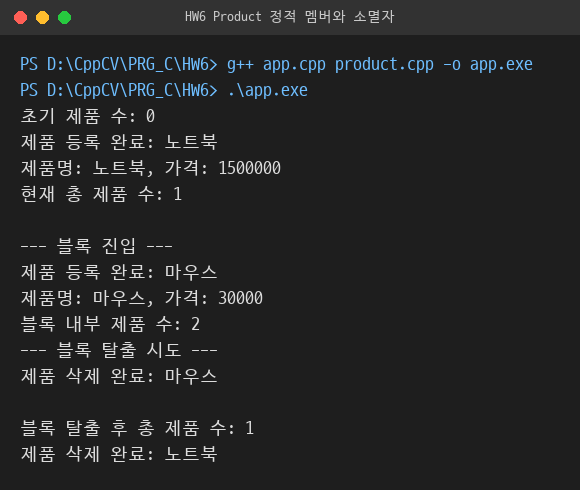

# HW6 · 제품 등록 수 관리

정적 멤버로 등록된 제품 수를 관리하는 Product 클래스와 블록 종료 시점의 소멸자 호출 확인 프로그램 구현.

## 다룬 개념

| 개념 | 뜻과 사용 방법 |
|---|---|
| `static` 멤버 변수 | 객체마다 따로 있지 않고 클래스 전체가 하나를 공유하는 변수. 클래스 밖에서 `int Product::totalCount = 0;`으로 정의와 초기화 |
| `static` 멤버 함수 | 객체 없이 `클래스명::함수명()`으로 호출하는 함수. `Product::getTotalCount()`로 객체를 만들기 전에도 제품 수 조회 |
| 생성자·소멸자 | 생성자는 객체가 만들어질 때, 소멸자는 객체가 사라질 때 자동 호출되는 함수. 생성자에서 `totalCount++`, 소멸자에서 `totalCount--` |
| 객체 수명과 블록 | 중괄호 블록 안에서 만든 지역 객체는 블록이 끝나는 순간 소멸자 호출. 블록 진입 전·안·탈출 후 제품 수를 출력해 소멸 시점 확인 |
| `assert` | 조건이 거짓이면 프로그램을 멈추는 검사. 생성자에서 `assert(p >= 0)`으로 음수 가격 거부 |
| 파일 분리 | 선언은 `product.h`, 정의는 `product.cpp`, 사용은 `app.cpp`에 두는 구조. 헤더 가드 `#ifndef PRODUCT_H`로 중복 포함 방지 |

## 파일별 내용

| 파일 | 내용 | 핵심 코드 |
|---|---|---|
| [product.h](product.h) | Product 클래스 선언. 이름·가격 데이터, 정적 제품 수, 정보 출력 함수 | `static int totalCount;`, `static int getTotalCount();` |
| [product.cpp](product.cpp) | 정적 멤버 초기화, 생성자에서 가격 검사·수 증가·등록 메시지, 소멸자에서 수 감소·삭제 메시지 | `int Product::totalCount = 0;`, `assert(p >= 0);` |
| [app.cpp](app.cpp) | 노트북 객체 생성 후 블록 안에서 마우스 객체 생성, 블록 진입 전·안·탈출 후 제품 수 출력 | `Product::getTotalCount()`, `{ Product p2("마우스", 30000); ... }` |

## 실행 흐름

| 시점 | 호출 | 제품 수 |
|---|---|---|
| 프로그램 시작 | 객체 없이 `Product::getTotalCount()` 호출 | 0 |
| `p1` 생성 | 생성자, `제품 등록 완료: 노트북` | 1 |
| 블록 안 `p2` 생성 | 생성자, `제품 등록 완료: 마우스` | 2 |
| 블록 종료 | `p2` 소멸자, `제품 삭제 완료: 마우스` | 1 |
| `main` 종료 | `p1` 소멸자, `제품 삭제 완료: 노트북` | 0 |

## 빌드와 실행 결과

```bash
g++ app.cpp product.cpp -o app.exe
```


