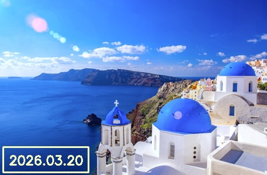
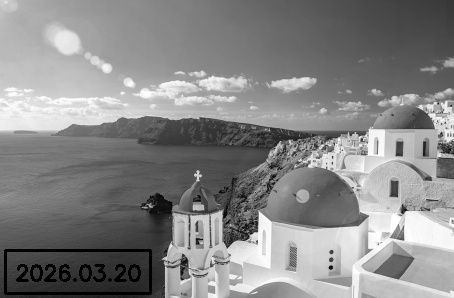
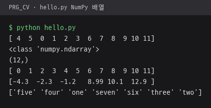
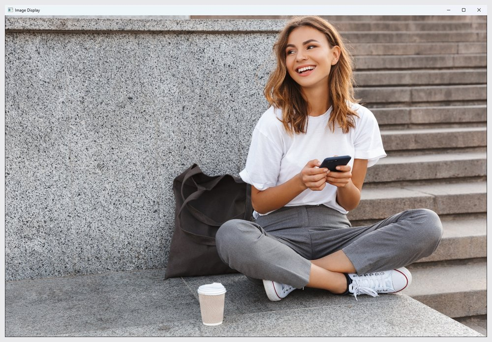
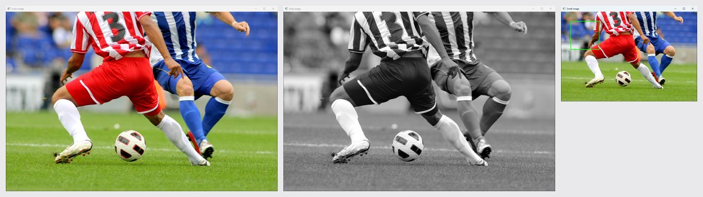
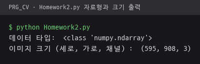
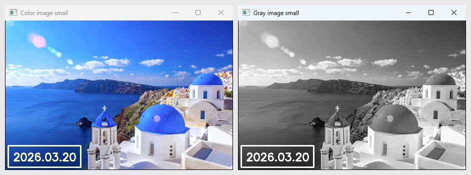
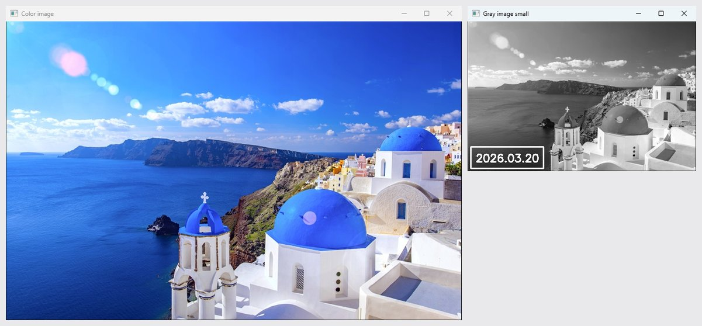
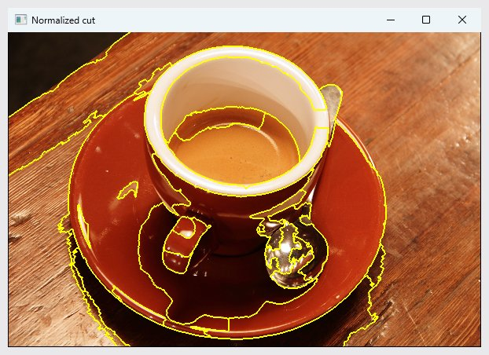

# PRG_CV · OpenCV 영상 처리와 딥러닝 비전

Python과 OpenCV로 만든 영상 처리 예제와 TensorFlow·PyTorch 기반 딥러닝 비전 예제. 장마다 폴더 하나로 구성.

## 장 목록

| 장 | 주제 | 주요 내용 |
|---|---|---|
| [ch2](ch2/README.md) | OpenCV 입출력과 마우스 | 영상·웹캠 입출력, 도형·글씨 그리기, 마우스 콜백 그림판 |
| [ch3](ch3/README.md) | 화소 처리 | 채널 분리, 히스토그램, 오츄 이진화, 모폴로지, 감마 보정, 히스토그램 평활화, 가우시안 블러, 엠보싱, 보간, 회전 |
| [ch4](ch4/README.md) | 에지·윤곽선과 영역 분할 | 소벨·캐니 에지, 윤곽선, 사과 검출·개수 세기, SLIC 슈퍼픽셀, 정규화 절단, GrabCut, 형상 특징 |
| [ch5](ch5/README.md) | 지역 특징 | 해리스 특징점, SIFT, FLANN 매칭과 비율 검사, RANSAC 호모그래피 |
| [ch6](ch6/README.md) | PyQt5 비전 응용 | GrabCut 오림, 교통약자 표지판 인식, 파노라마 봉합, 특수 효과, 어린이보호구역 속도 표지판 검출 |
| [ch7](ch7/README.md) | 다층 퍼셉트론 | MNIST·CIFAR-10 분류, SGD·Adam 비교, 배치 정규화·드롭아웃, 필기 숫자 인식 |
| [ch8](ch8/README.md) | 컨볼루션 신경망 | LeNet-5, CIFAR-10 CNN, 데이터 증대, ResNet50 분류, DenseNet121 전이 학습 견종 분류 |
| [ch9](ch9/README.md) | 검출과 분할 | YOLO v3 검출, U-net 분할 학습, DeepLabv3 의미 분할, Mask R-CNN 사례 분할, 배경 흐림·색 변경 |
| [ch10](ch10/README.md) | 추적과 사람 인식 | Farneback·Lucas-Kanade 광류, YOLO v3와 SORT 사람 추적, MediaPipe 얼굴·손·자세, 손가락 그림판 |
| [ch11](ch11/README.md) | 트랜스포머 | CIFAR-10 ViT 구성, 사전 학습 ViT 분류, DETR 검출, CLIP 영상-문장 유사도 |
| [ch12](ch12/README.md) | 3차원 비전 | ModelNet10 점 구름 시각화, PointNet 분류 |
| [ch13](ch13/README.md) | 생성 모델 | 가우시안 샘플 생성, 가우시안 혼합, 오토인코더, VAE, DCGAN, Stable Diffusion |

ch6과 ch9는 소스가 하위 폴더 `ch6/ch6/`, `ch9/ch9/`에 위치.

## 폴더 바로 아래 파일

| 파일 | 내용 | 핵심 코드 |
|---|---|---|
| [hello.py](hello.py) | 정수·실수·문자열 NumPy 배열을 만들어 정렬, `ch2/2-1.py`와 같은 예제를 `from numpy import *`로 작성 | `array`, `shape`, `sort` |
| [CV.py](CV.py) | 사진을 읽어 창에 표시. `soccer.jpg`를 읽은 뒤 `girl_laughing.jpg`로 다시 읽어 두 번째 사진 표시 | `cv.imread`, `cv.imshow` |
| [img2.py](img2.py) | 원본과 명암 영상, 초록 사각형을 그린 0.5배 축소 영상 표시 | `cv.resize`, `cv.cvtColor`, `cv.rectangle` |
| [cam.py](cam.py) | 웹캠 프레임을 계속 표시하고 `q` 키로 종료, `ch2/2-4.py`와 같은 흐름 | `cv.VideoCapture`, `cap.read` |
| [Homework2.py](Homework2.py) | 과제 2. 산토리니 사진의 자료형·크기 출력, 컬러·명암 영상을 0.5배 축소하고 날짜 상자와 `2026.03.20` 글씨 표시 | `cv.cvtColor`, `cv.resize`, `cv.rectangle`, `cv.putText` |
| [Homework2_2.py](Homework2_2.py) | 과제 2 변형. 원본 컬러 영상과 날짜를 넣은 0.5배 축소 명암 영상 표시 | `cv.resize`, `cv.putText` |
| [4-6.py](4-6.py) | `ch4/4-6.py`와 같은 정규화 절단 분할. `skimage`의 `graph`, `segmentation`, `data`를 따로 불러오는 방식 | `segmentation.slic`, `graph.cut_normalized` |

`soccer.jpg`, `girl_laughing.jpg`, `santorini.jpg`: 입력 사진. `santorini_small_text.jpg`, `santorini_small_gray_text.jpg`: 과제 2 결과 영상.

## 과제 2 결과

| 컬러 축소 | 명암 축소 |
|---|---|
|  |  |

## 실행 결과

Python 3.11, OpenCV 4.13.0으로 실행한 화면. OpenCV 창은 Win32 `PrintWindow`로 창 그대로 찍은 사진.

| `hello.py` NumPy 배열 정렬 | `CV.py`. 두 번째로 읽은 `girl_laughing.jpg` 표시 |
|---|---|
|  |  |

| `img2.py` 원본, 명암, 초록 사각형을 그린 0.5배 축소 창 | `Homework2.py` 자료형과 크기 출력 |
|---|---|
|  |  |

| `Homework2.py` 0.5배 축소 컬러·명암 창과 날짜 표기 | `Homework2_2.py` 원본 컬러 창과 날짜를 넣은 축소 명암 창 |
|---|---|
|  |  |

`4-6.py` 정규화 절단 분할. scikit-image가 있는 Python 3.14에서 실행.



## 실행 방법

```bash
pip install opencv-contrib-python numpy matplotlib scikit-image PyQt5
cd PRG_CV/ch4
python 4-4.py
```

- 영상 파일을 상대 경로로 읽으므로 스크립트가 있는 폴더에서 실행.
- ch6 유화 효과 `cv.xphoto`는 `opencv-contrib-python` 필요.
- ch7 이후는 TensorFlow, PixelLib, MediaPipe, filterpy, Transformers, PyTorch, trimesh, scikit-learn, keras_cv 사용.
- 학습된 모델 파일, 데이터셋, 동영상은 저장소에 없어 실행 전 별도 준비. 장별 필요 파일은 각 장 README에 표기.
