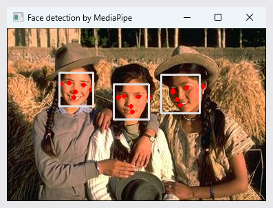

# ch10 · 추적과 사람 인식

연속 프레임 사이 움직임을 구하는 광류, 프레임마다 검출한 사람에게 같은 번호를 이어 붙이는 다중 물체 추적, MediaPipe 얼굴·손·자세 인식과 손가락 그림판 구현.

## 다룬 개념

| 개념 | 뜻과 사용 방법 |
|---|---|
| 광류 | 연속한 두 프레임에서 화소가 움직인 방향과 거리. Farneback 방법은 모든 화소의 광류를 구하는 밀집 광류. `cv.calcOpticalFlowFarneback` 결과를 격자 간격마다 선으로 그리고 움직임이 큰 곳은 빨강, 작은 곳은 초록으로 구분 |
| Lucas-Kanade 광류 추적 | 추적하기 좋은 특징점만 골라 그 점들의 이동을 영상 피라미드에서 구하는 희소 광류. `cv.goodFeaturesToTrack`으로 점 선택, `cv.calcOpticalFlowPyrLK`로 다음 위치 계산, 이동 궤적을 별도 영상에 누적해 `cv.add`로 합성 |
| 다중 물체 추적 SORT | 프레임마다 검출한 박스를 기존 추적 대상의 예측 위치와 짝지어 같은 물체에 같은 번호를 붙이는 추적 방법. YOLO v3 결과에서 부류 0인 사람만 골라 `Sort.update`에 넘기고 번호별 색 사각형 표시 |
| 칼만 필터 | 이전 추정과 새 관측을 각각의 불확실성에 따라 섞어 다음 상태를 예측·보정하는 방법. `sort.py`가 박스 중심·넓이·가로세로 비율과 속도를 `filterpy`의 `KalmanFilter`로 추정 |
| IoU | 두 박스가 겹친 넓이를 두 박스를 합친 넓이로 나눈 값. `sort.py`의 `iou_batch`로 검출 박스와 예측 박스의 짝짓기 기준 계산 |
| MediaPipe | 구글이 공개한 얼굴·손·자세 인식 라이브러리. RGB 영상을 `process`에 넘기면 검출 결과와 랜드마크 좌표 반환 |
| 얼굴 검출과 증강 현실 | 얼굴 박스와 눈·코 같은 핵심점을 찾는 처리. 증강 현실은 찾은 위치에 가상 물체를 합성하는 기술. 오른쪽 눈 위치에 주사위 그림을 알파 채널 비율로 합성 |
| 랜드마크 | 얼굴 그물망, 손가락 관절, 몸 관절처럼 신체 부위 위치를 나타내는 점 집합. `FaceMesh`, `Hands`, `Pose` 결과를 `draw_landmarks`로 표시 |
| 손가락 펴짐 판정 | 손가락 끝 랜드마크가 가운데 관절보다 위에 있으면 편 손가락으로 보는 규칙. 검지 끝 8번과 관절 6번, 중지 끝 12번과 관절 10번의 y 좌표 비교 |
| 마스크 합성 | 그림 캔버스의 선 부분만 카메라 화면 위에 덮는 처리. 캔버스를 역이진화해 선 자리만 0인 마스크를 만들고 `cv2.bitwise_and`로 비운 뒤 `cv2.bitwise_or`로 선 합성 |

## 파일별 내용

| 파일 | 내용 | 핵심 코드 |
|---|---|---|
| [10-1.py](10-1.py) | 웹캠 프레임 사이 Farneback 광류를 16 화소 간격 선으로 표시 | `cv.calcOpticalFlowFarneback`, `cv.line` |
| [10-2.py](10-2.py) | 동영상 `slow_traffic_small.mp4`에서 특징점을 골라 Lucas-Kanade 광류로 추적, 이동 궤적 표시 | `cv.goodFeaturesToTrack`, `cv.calcOpticalFlowPyrLK` |
| [10-3.py](10-3.py) | 웹캠 영상에서 YOLO v3로 사람을 검출하고 SORT로 추적 번호 부여 | `cv.dnn.readNet`, `cv.dnn.NMSBoxes`, `Sort.update` |
| [10-4.py](10-4.py) | 사진에서 MediaPipe 얼굴 검출, 박스와 핵심점 표시 | `mp.solutions.face_detection`, `draw_detection` |
| [10-5.py](10-5.py) | 웹캠 영상에 얼굴 검출 적용, 좌우 반전 표시 | `FaceDetection`, `cv.flip` |
| [10-6.py](10-6.py) | 얼굴 오른쪽 눈 위치에 주사위 그림을 투명도 합성하는 증강 현실 | `get_key_point`, `FaceKeyPoint.RIGHT_EYE`, `cv.IMREAD_UNCHANGED` |
| [10-7.py](10-7.py) | 얼굴 최대 두 개의 그물망, 윤곽, 홍채 랜드마크 표시 | `FaceMesh`, `FACEMESH_TESSELATION`, `FACEMESH_IRISES` |
| [10-8.py](10-8.py) | 두 손의 관절 랜드마크와 연결선 표시 | `Hands`, `HAND_CONNECTIONS` |
| [10-9.py](10-9.py) | 몸 자세 랜드마크 표시, 종료 시 3차원 자세 그래프 출력 | `Pose`, `POSE_CONNECTIONS`, `plot_landmarks` |
| [sort.py](sort.py) | Alex Bewley의 SORT 추적기 공개 코드. 칼만 필터 박스 추적과 IoU 기반 짝짓기, 10-3에서 사용 | `KalmanBoxTracker`, `associate_detections_to_trackers`, `Sort` |
| [test.py](test.py) | 손가락 그림판. 검지만 펴면 선 그리기, 검지·중지를 펴면 화면 위 색 칸에서 빨강·초록·파랑 선택과 전체 지우기, Esc 키로 종료 | `mp_hands.Hands`, `cv2.threshold`, `cv2.bitwise_and` |

`BSDS_242078.jpg`, `BSDS_361010.jpg`, `BSDS_376001.jpg`: 사진 자료, 이 장에서는 `BSDS_376001.jpg`를 10-4 입력으로 사용. `dice.png`: 알파 채널이 있는 주사위 그림. `coco_names.txt`, `yolov3.cfg`: YOLO v3 부류 이름과 신경망 구성 파일.

실행에 필요한 `yolov3.weights`와 `slow_traffic_small.mp4`는 저장소에 없어 실행 전 별도 준비.

## 실행 결과

MediaPipe 얼굴 검출 `10-4.py`. `BSDS_376001.jpg`에서 얼굴 3개의 박스와 핵심점 표시. Python 3.11, MediaPipe 0.10.14로 실행하고 창을 `PrintWindow`로 찍은 사진.

