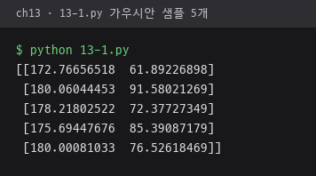
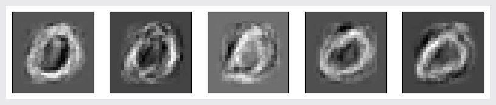
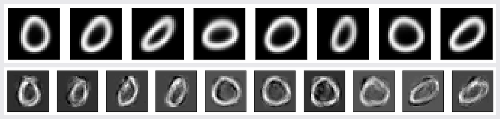
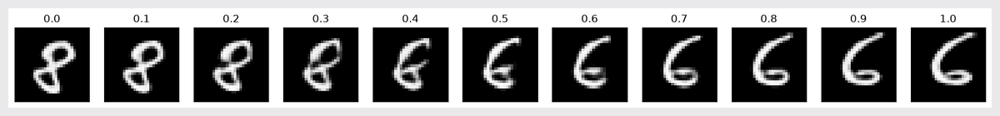

# ch13 · 생성 모델

학습 데이터의 분포를 본떠 새 샘플을 만드는 생성 모델. 가우시안 샘플링, 가우시안 혼합, 오토인코더, VAE, DCGAN, Stable Diffusion 문장-영상 생성 구현.

## 다룬 개념

| 개념 | 뜻과 사용 방법 |
|---|---|
| 생성 모델 | 데이터가 따르는 확률 분포를 학습해 그 분포에서 새 샘플을 뽑는 모델 |
| 다변량 가우시안 | 평균 벡터와 공분산 행렬로 정해지는 다차원 정규 분포. 자료의 평균 `np.mean`과 공분산 `np.cov`를 구해 `np.random.multivariate_normal`로 샘플 생성 |
| 가우시안 혼합 | 여러 가우시안을 가중합해 복잡한 분포를 나타내는 모델. `GaussianMixture(n_components=8)`로 숫자 0 영상을 학습해 가우시안별 평균 영상과 생성 샘플 표시 |
| 오토인코더 | 입력을 작은 잠복 벡터로 줄이는 인코더와 다시 복원하는 디코더를 이어 붙여 입력 자체를 맞히도록 학습하는 신경망. 두 테스트 영상의 잠복 벡터 사이를 등간격으로 섞어 디코더로 중간 영상 생성 |
| VAE | 잠복 공간을 평균과 분산을 가진 분포로 학습하는 오토인코더. 평균·로그 분산에서 무작위 잠복 벡터를 뽑는 `Sampling` 층, 복원 손실과 KL 발산 손실의 합을 `train_step`에서 계산 |
| GAN | 가짜 영상을 만드는 생성기와 진짜·가짜를 가리는 판별기를 서로 경쟁시키며 학습하는 구조. 판별기와 생성기를 번갈아 `train_on_batch`로 학습 |
| DCGAN | 생성기와 판별기를 컨볼루션층으로 구성한 GAN. 판별기는 `Conv2D`와 `LeakyReLU`, 생성기는 `Conv2DTranspose`와 `tanh` 출력 |
| 확산 모델 | 잡음에서 시작해 잡음을 조금씩 걷어 내며 문장 설명에 맞는 영상을 만드는 생성 모델. `keras_cv.models.StableDiffusion`의 `text_to_image` |

## 파일별 내용

| 파일 | 내용 | 핵심 코드 |
|---|---|---|
| [13-1.py](13-1.py) | 두 값으로 된 작은 자료의 평균·공분산으로 가우시안 샘플 생성 | `np.mean`, `np.cov`, `np.random.multivariate_normal` |
| [13-2.py](13-2.py) | MNIST 숫자 0 영상 전체의 평균·공분산으로 새 숫자 영상 생성 | `np.isin`, `np.cov` |
| [13-3.py](13-3.py) | 숫자 0 영상에 가우시안 혼합 모델 학습, 가우시안별 평균 영상과 생성 샘플 표시 | `GaussianMixture`, `gm.means_`, `gm.sample` |
| [13-4.py](13-4.py) | 컨볼루션 오토인코더로 MNIST 학습, 두 영상의 잠복 벡터 사이 보간 결과 표시 | `Conv2D`, `Conv2DTranspose`, `Model` |
| [13-5.py](13-5.py) | VAE를 `keras.Model` 상속 클래스로 구성해 학습, 잠복 공간 보간 결과 표시 | `Sampling`, `tf.GradientTape`, `binary_crossentropy` |
| [13-6.py](13-6.py) | Fashion-MNIST 8번 부류 영상으로 DCGAN 학습, 10 에포크마다 생성 영상 표시 | `make_discriminator`, `make_generator`, `train_on_batch` |
| [13-7.py](13-7.py) | CIFAR-10 1번 자동차 부류로 컬러 영상 DCGAN 학습 | `Conv2DTranspose`, `Conv2D(3, (3, 3), activation="tanh")` |
| [13-8.py](13-8.py) | Stable Diffusion으로 `A cute rabbit in an avocado armchair` 문장에서 512×512 영상 생성 | `keras_cv.models.StableDiffusion`, `text_to_image` |

## 실행 결과

Python 3.11, TensorFlow 2.21 CPU로 실행한 결과. 학습 로그는 터미널 출력의 연속된 끝부분, 그래프와 영상 목록은 `plt.show` 시점의 figure를 그대로 저장한 사진. MNIST·CIFAR-10은 Keras 데이터셋 캐시 사용.

| 가우시안 샘플 5개 `13-1.py` | 숫자 0 영상 평균·공분산으로 생성한 영상 5장 `13-2.py` |
|---|---|
|  |  |

가우시안 혼합 `13-3.py`. 위 가우시안 8개의 평균 영상, 아래 생성 샘플 10개.

컨볼루션 오토인코더 `13-4.py`. 50 에포크 학습 뒤 두 영상의 잠복 벡터 사이 0.0~1.0 보간으로 생성한 11장.

