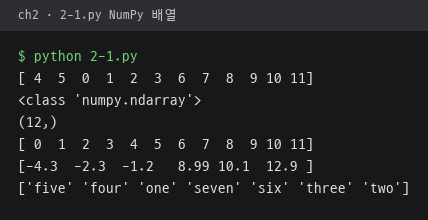
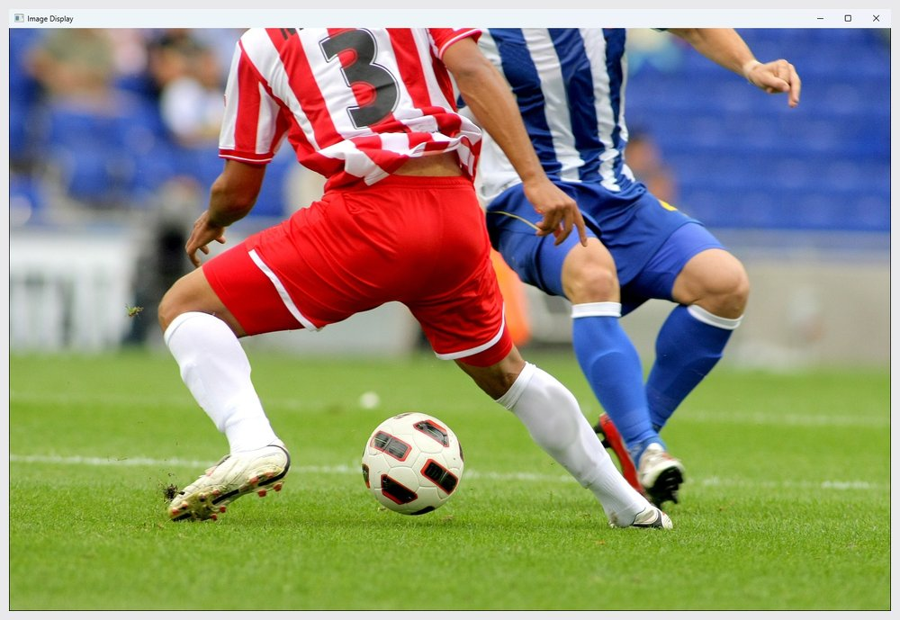
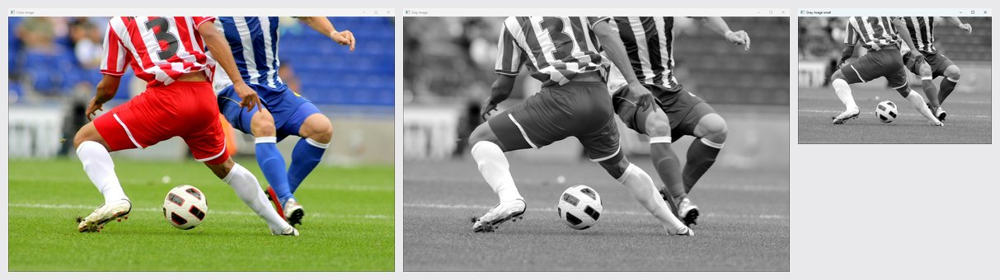
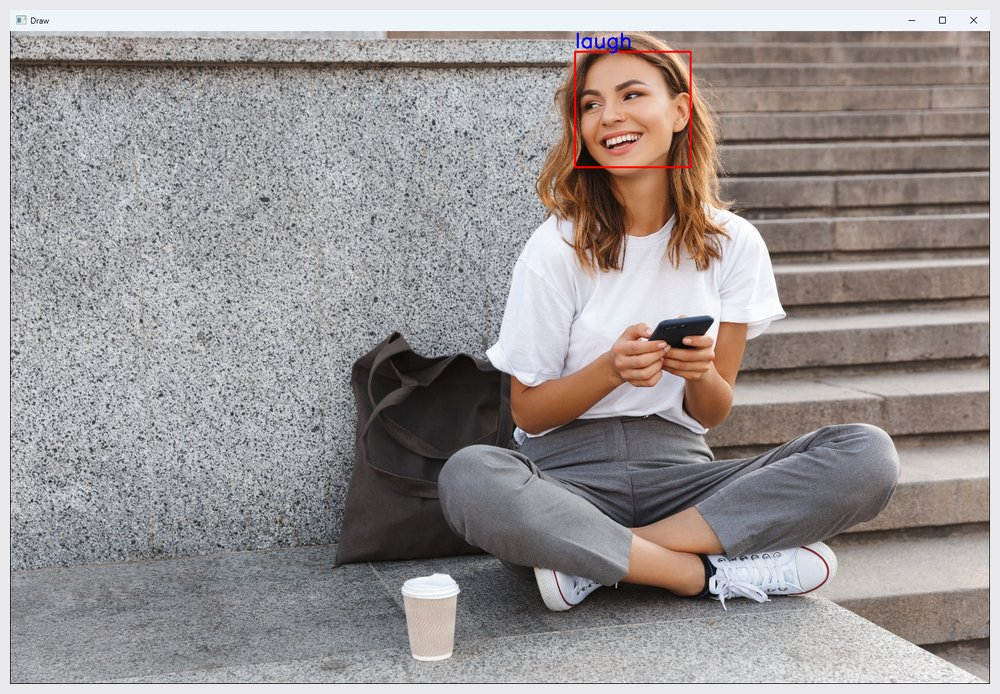
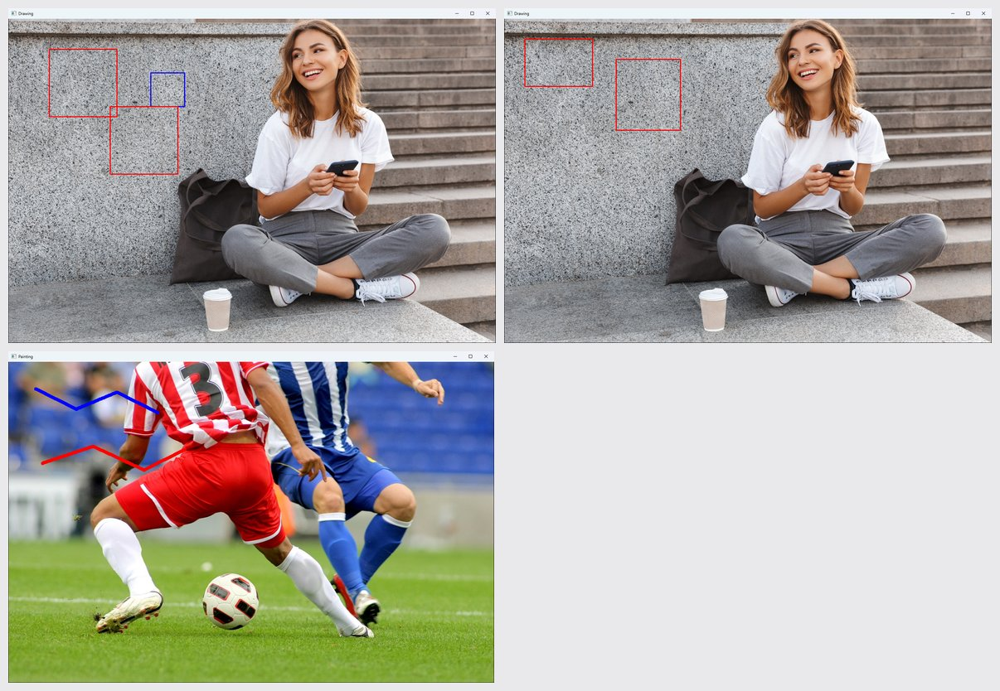

# ch2 · OpenCV 입출력과 마우스

NumPy 배열, 영상 파일과 웹캠 프레임 입출력, 도형·글씨 그리기, 마우스 콜백 그림판 구현.

## 다룬 개념

| 개념 | 뜻과 사용 방법 |
|---|---|
| NumPy 배열 | 같은 자료형 값을 담는 다차원 배열이자 OpenCV 영상의 저장 형식. `np.array`로 정수·실수·문자열 배열을 만들고 `shape`로 크기 확인, `sort`로 정렬 |
| 영상 읽기와 표시 | 영상 파일의 화소 값을 배열로 불러와 창에 띄우는 처리. `cv.imread`로 읽고 `None`이면 종료, `cv.imshow`로 표시, `cv.waitKey`로 키 입력 대기 |
| 명암 변환과 크기 조정 | 컬러 영상을 밝기 한 채널 영상으로 바꾸는 처리와 영상 확대·축소. `cv.cvtColor`에 `COLOR_BGR2GRAY` 지정, `cv.resize`에 `fx=0.5, fy=0.5`로 절반 축소, `cv.imwrite`로 파일 저장 |
| 비디오 프레임 획득 | 카메라 영상을 한 장씩 이어 받는 처리. `cv.VideoCapture(0, cv.CAP_DSHOW)`로 웹캠 연결, 반복문에서 `read`로 프레임을 받고 `q` 키로 종료 |
| 프레임 이어 붙이기 | 여러 영상을 가로로 이어 한 장으로 만드는 처리. `c` 키로 모은 프레임을 `np.hstack`으로 연결 |
| 도형과 글씨 그리기 | 영상 배열 위에 사각형·원·문자열을 덧그리는 처리. `cv.rectangle`, `cv.circle`, `cv.putText`에 좌표, BGR 색, 두께 지정 |
| 마우스 콜백 | 창에서 마우스 이벤트가 생길 때마다 호출되는 함수. `cv.setMouseCallback`으로 창에 등록하고 `EVENT_LBUTTONDOWN`, `EVENT_LBUTTONUP`, `EVENT_MOUSEMOVE`와 `EVENT_FLAG_LBUTTON`으로 클릭과 끌기 구분 |

## 파일별 내용

| 파일 | 내용 | 핵심 코드 |
|---|---|---|
| [2-1.py](2-1.py) | 정수·실수·문자열 NumPy 배열을 만들어 자료형과 크기 출력 후 정렬 | `np.array`, `shape`, `sort` |
| [2-2.py](2-2.py) | 사진을 읽어 창에 표시, 파일이 없으면 종료 | `cv.imread`, `cv.imshow`, `cv.waitKey` |
| [2-3.py](2-3.py) | 명암 영상 변환과 절반 축소, 두 결과를 파일로 저장하고 세 영상 표시 | `cv.cvtColor`, `cv.resize`, `cv.imwrite` |
| [2-4.py](2-4.py) | 웹캠 프레임을 계속 받아 표시, `q` 키로 종료 | `cv.VideoCapture`, `cap.read`, `cap.release` |
| [2-5.py](2-5.py) | 웹캠 화면에서 `c` 키로 프레임 수집, 종료 후 최대 세 장을 가로로 이어 표시 | `frames.append`, `np.hstack` |
| [2-6.py](2-6.py) | 사진의 지정 위치에 빨간 사각형과 파란 `laugh` 글씨 표시 | `cv.rectangle`, `cv.putText` |
| [2-7.py](2-7.py) | 왼쪽 클릭 위치에 큰 빨간 사각형, 오른쪽 클릭 위치에 작은 파란 사각형 그리기 | `cv.setMouseCallback`, `EVENT_LBUTTONDOWN`, `EVENT_RBUTTONDOWN` |
| [2-8.py](2-8.py) | 왼쪽 버튼을 누른 점과 뗀 점을 두 꼭짓점으로 사각형 그리기 | `EVENT_LBUTTONDOWN`, `EVENT_LBUTTONUP`, `global ix,iy` |
| [2-9.py](2-9.py) | 마우스 붓 칠 그림판. 왼쪽 버튼은 파란색, 오른쪽 버튼은 빨간색, 버튼을 누른 채 끌면 연속 칠 | `cv.circle`, `EVENT_MOUSEMOVE`, `EVENT_FLAG_LBUTTON` |

`soccer.jpg`, `girl_laughing.jpg`: 예제 입력 사진.

## 실행 결과

Python 3.11, OpenCV 4.13.0으로 실행한 화면. OpenCV 창은 Win32 `PrintWindow`로 창 그대로 찍은 사진. 마우스 예제는 등록된 콜백 함수에 클릭·끌기 이벤트를 차례로 넣어 실행한 결과.

| NumPy 배열 생성과 정렬 `2-1.py` | 사진 표시 `2-2.py` |
|---|---|
|  |  |

| 명암 변환과 절반 축소 `2-3.py`. 왼쪽부터 컬러·명암·축소 창 | 빨간 사각형과 파란 `laugh` 글씨 `2-6.py` |
|---|---|
|  |  |

마우스 콜백 `2-7.py`, `2-8.py`, `2-9.py`. 위 왼쪽은 왼쪽 클릭 두 번과 오른쪽 클릭 한 번, 위 오른쪽은 누른 점과 뗀 점으로 그린 사각형 두 개, 아래는 왼쪽·오른쪽 버튼 끌기 붓 칠.

