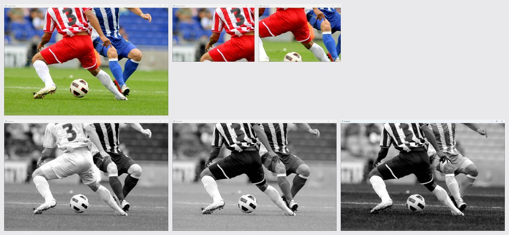
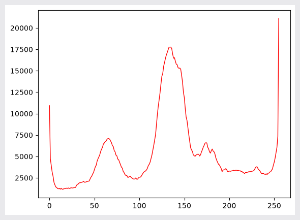
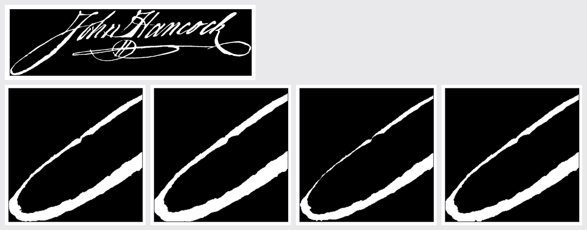
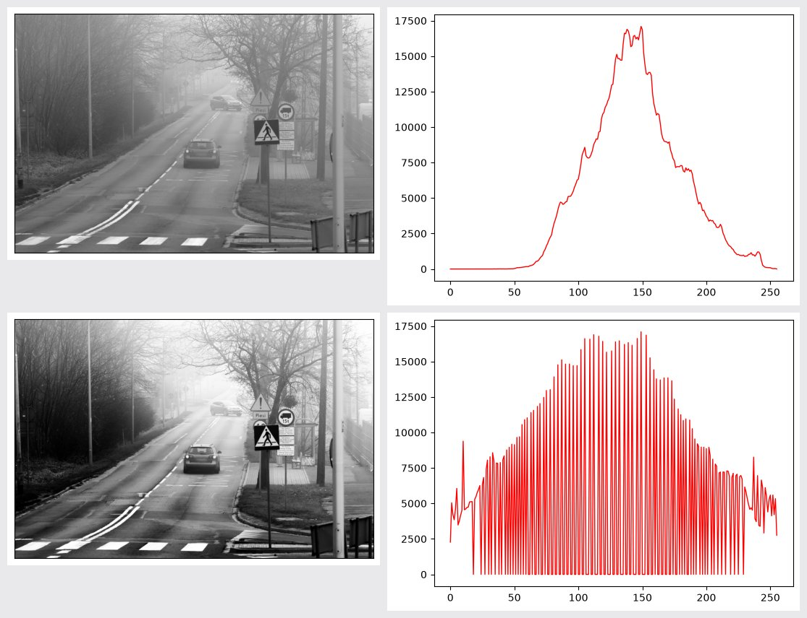
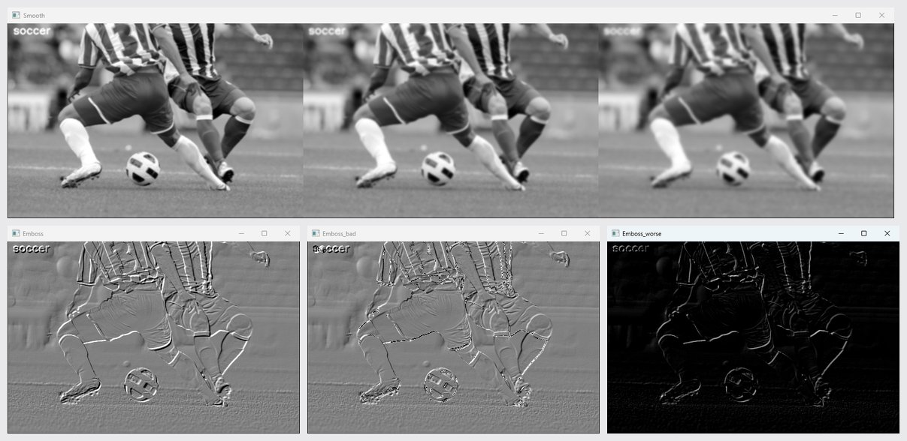
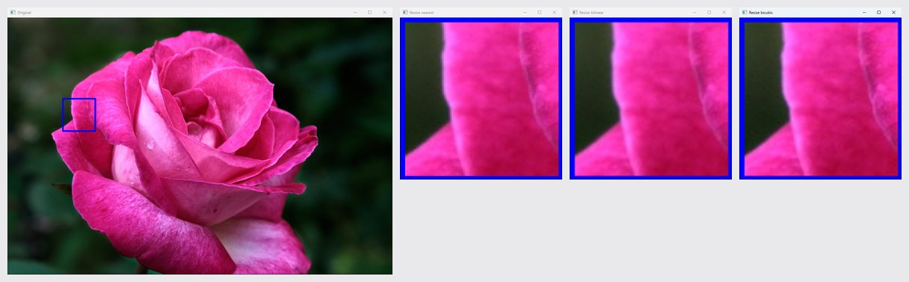
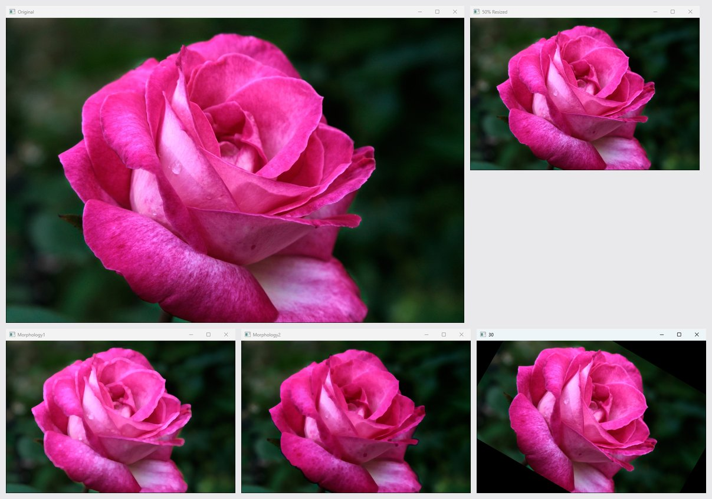

# ch3 · 화소 처리

화소 값과 색 채널을 바꾸는 영상 처리. 히스토그램, 오츄 이진화, 모폴로지, 감마 보정, 히스토그램 평활화, 가우시안 블러, 엠보싱, 보간, 회전 변환 구현.

## 다룬 개념

| 개념 | 뜻과 사용 방법 |
|---|---|
| 화소 접근과 채널 분리 | 영상 배열의 행·열·채널 인덱스로 일부 영역이나 한 색 채널만 꺼내는 처리. OpenCV 컬러 영상은 B, G, R 순서로 저장되어 `img[:,:,2]`가 R 채널. 슬라이싱으로 왼쪽 위 영역과 가운데 영역 추출 |
| 히스토그램 | 밝기 값마다 화소 수를 센 분포. `cv.calcHist`로 R 채널과 명암 영상의 히스토그램을 구해 `plt.plot`으로 그래프 표시 |
| 이진화와 오츄 알고리즘 | 임곗값을 기준으로 화소를 0과 255 두 값으로 나누는 처리. 오츄 알고리즘은 두 집단 내부 분산의 합이 가장 작아지는 임곗값을 자동으로 찾는 방법. `cv.threshold`에 `THRESH_BINARY+THRESH_OTSU` 지정 |
| 모폴로지 연산 | 구조 요소라는 작은 모양 틀로 이진 영상의 물체 모양을 다듬는 연산. 팽창은 물체를 키우고 침식은 깎아 내며, 닫기는 팽창 뒤 침식으로 작은 구멍을 메우는 연산. `cv.dilate`, `cv.erode`, 마름모 모양 구조 요소와 `cv.getStructuringElement` 사각형 구조 요소 |
| 감마 보정 | 화소 값을 0~1로 정규화한 뒤 감마 거듭제곱으로 밝기 곡선을 바꾸는 처리. 감마 1 미만은 밝게, 1 초과는 어둡게 변환. NumPy 거듭제곱 `f1**gamma`로 구현 |
| 히스토그램 평활화 | 한쪽에 몰린 밝기 분포를 전 범위로 고르게 펴서 대비를 높이는 처리. `cv.equalizeHist` 적용 전후 영상과 히스토그램 비교 |
| 가우시안 블러 | 가우시안 분포 가중치로 주변 화소를 평균 내 영상을 흐리게 하는 필터. `cv.GaussianBlur`의 커널 크기를 5, 9, 15로 바꿔 흐림 정도 비교 |
| 컨볼루션 필터와 엠보싱 | 컨볼루션은 작은 가중치 행렬을 영상 위로 옮기며 곱해 더하는 연산. 엠보싱은 대각선 방향 밝기 차이로 돋을새김처럼 보이게 하는 필터. `cv.filter2D`에 엠보싱 커널 적용, `int16` 변환과 `np.clip` 유무에 따른 결과 비교 |
| 보간법 | 영상을 확대할 때 새로 생기는 화소 값을 주변 화소로 채우는 방법. 최근접 `INTER_NEAREST`, 양선형 `INTER_LINEAR`, 양3차 `INTER_CUBIC` 결과 비교 |
| 기하 변환 | 화소 값 대신 화소 위치를 옮기는 변환. 회전 중심과 각도로 변환 행렬을 만든 뒤 영상 전체에 적용. `cv.getRotationMatrix2D`, `cv.warpAffine` |
| 반복문과 배열 연산 | 화소마다 반복문으로 계산하는 방식과 NumPy 배열 연산으로 한 번에 계산하는 방식. 명암 변환을 두 방식과 `cv.cvtColor`로 각각 수행해 실행 시간 비교 |

## 파일별 내용

| 파일 | 내용 | 핵심 코드 |
|---|---|---|
| [3-1.py](3-1.py) | 사진의 왼쪽 위 영역, 가운데 영역, R·G·B 채널을 각각 창에 표시 | `img.shape[0]//2` 슬라이싱, `img[:,:,2]` |
| [3-2.py](3-2.py) | R 채널 히스토그램을 선 그래프로 표시 | `cv.calcHist`, `plt.plot` |
| [3-3.py](3-3.py) | R 채널에 오츄 이진화 적용, 찾은 임곗값 출력 | `cv.threshold`, `THRESH_OTSU` |
| [3-4.py](3-4.py) | 서명 영상의 알파 채널을 이진화한 뒤 왼쪽 아래 영역에 팽창·침식·닫기 적용 | `cv.IMREAD_UNCHANGED`, `cv.dilate`, `cv.erode` |
| [3-5.py](3-5.py) | 감마 0.5, 0.75, 1.0, 2.0, 3.0 결과를 가로로 이어 비교 | `gamma()`, `np.hstack` |
| [3-6.py](3-6.py) | 명암 영상의 히스토그램 평활화 전후 영상과 히스토그램 비교 | `cv.equalizeHist`, `cv.calcHist` |
| [3-7.py](3-7.py) | 커널 크기별 가우시안 블러 비교, 엠보싱 결과를 값 범위 처리 방식별로 비교 | `cv.GaussianBlur`, `cv.filter2D`, `np.clip` |
| [3-8.py](3-8.py) | `rose.png` 일부 영역을 잘라 5배 확대, 보간법 세 가지 비교 | `cv.resize`, `interpolation=cv.INTER_CUBIC` |
| [3-8-1.py](3-8-1.py) | 같은 영상을 절반 축소한 뒤 사각형 구조 요소로 침식·팽창, 시계 방향 30도 회전 | `cv.getStructuringElement`, `cv.getRotationMatrix2D`, `cv.warpAffine` |
| [3-9.py](3-9.py) | 명암 변환을 이중 반복문, NumPy 배열 연산, OpenCV 함수로 각각 수행해 실행 시간 출력 | `my_cvtGray1`, `my_cvtGray2`, `time.time` |

`soccer.jpg`, `mistyroad.jpg`, `rose.png`, `JohnHancocksSignature.png`: 예제 입력 영상.

## 실행 결과

Python 3.11, OpenCV 4.13.0으로 실행한 화면. OpenCV 창은 Win32 `PrintWindow`로 창 그대로 찍은 사진. matplotlib 그래프는 `plt.show` 시점의 figure를 그대로 저장한 사진.

| 채널 분리 `3-1.py`. 위 원본·왼쪽 위 영역·가운데 영역, 아래 R·G·B 채널 | R 채널 히스토그램 `3-2.py` |
|---|---|
|  |  |

| 서명 영상 모폴로지 `3-4.py`. 위 이진화 영상, 아래 왼쪽 아래 영역과 팽창·침식·닫기 | 감마 0.5·0.75·1.0·2.0·3.0 비교 `3-5.py` |
|---|---|
|  |  |

| 히스토그램 평활화 `3-6.py`. 위 평활화 전, 아래 평활화 후 | 가우시안 블러 5·9·15 커널과 엠보싱 세 가지 `3-7.py` |
|---|---|
|  |  |

| 보간법 비교 `3-8.py`. 파란 사각형 영역을 최근접·양선형·3차 보간으로 5배 확대 | 절반 축소, 팽창 `Morphology1`, 침식 `Morphology2`, 30도 회전 `3-8-1.py` |
|---|---|
|  |  |

오츄 이진화 `3-3.py`. 왼쪽 R 채널, 오른쪽 이진화 영상.

