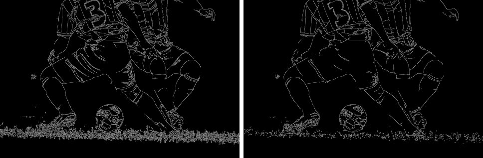
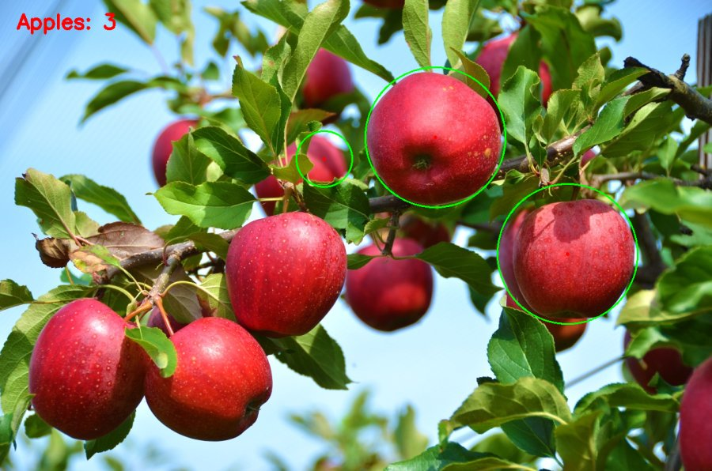

# ch4 · 에지·윤곽선과 영역 분할

밝기가 급하게 바뀌는 경계를 찾는 에지 검출, 경계를 이은 윤곽선 추출, 영상을 비슷한 영역으로 나누는 분할, 윤곽선 형상 분석과 사과 검출·개수 세기 구현.

## 다룬 개념

| 개념 | 뜻과 사용 방법 |
|---|---|
| 에지와 소벨 연산자 | 에지는 밝기가 급하게 바뀌는 화소. 소벨 연산자는 가로·세로 방향 밝기 변화량을 구하는 필터. `cv.Sobel`로 x·y 방향 미분 후 `cv.convertScaleAbs`로 절댓값을 취하고 `cv.addWeighted`로 합쳐 에지 강도 계산 |
| 캐니 에지 | 스무딩, 기울기 계산, 비최대 억제, 두 임곗값 이력 추적을 거쳐 얇고 이어진 에지를 얻는 방법. `cv.Canny`의 낮은·높은 임곗값을 50·150과 100·200으로 바꿔 비교 |
| 윤곽선 | 이진 영상에서 서로 이어진 경계 화소를 순서대로 묶은 점 목록. `cv.findContours`로 추출하고 길이·면적 조건으로 거른 뒤 `cv.drawContours`로 표시 |
| HSV 색 공간과 색 마스크 | 색상 H, 채도 S, 명도 V로 색을 나타내는 방식. 빨강은 색상 값의 양 끝에 걸쳐 있어 두 구간 마스크를 더해 사용. `cv.cvtColor`에 `COLOR_BGR2HSV`, `cv.inRange` |
| 모폴로지 열기·닫기 | 열기는 침식 뒤 팽창으로 작은 잡음 제거, 닫기는 팽창 뒤 침식으로 작은 구멍 메우기. `cv.morphologyEx`에 `MORPH_OPEN`, `MORPH_CLOSE` |
| 원형도 | 윤곽선이 원에 얼마나 가까운지 나타내는 값 `4π × 면적 / 둘레²`. 1에 가까울수록 원. 면적은 `cv.contourArea`, 둘레는 `cv.arcLength`로 계산 |
| 슈퍼픽셀 | 색과 위치가 비슷한 화소를 묶은 작은 영역. SLIC 알고리즘의 `compactness`를 20과 40으로 바꿔 영역 모양 비교. `skimage.segmentation.slic` |
| 정규화 절단 | 영역을 마디로, 영역 사이 유사도를 간선으로 하는 그래프를 만들어 연결이 약한 곳을 끊는 분할 방법. 슈퍼픽셀로 영역 인접 그래프를 만든 뒤 `skimage.graph.cut_normalized` 적용 |
| GrabCut | 사용자가 칠한 물체·배경 표시를 바탕으로 색 분포 모델을 반복 갱신하며 물체를 오려 내는 대화형 분할. 붓 칠로 만든 마스크를 `cv.grabCut`에 `GC_INIT_WITH_MASK`로 전달 |
| 형상 특징 | 윤곽선 모양을 수치로 나타내는 값. 모멘트로 중점을 구하고 면적·둘레·둥근 정도 계산. 볼록 헐은 윤곽선을 모두 감싸는 가장 작은 볼록 다각형. `cv.moments`, `cv.approxPolyDP`, `cv.convexHull` |

## 파일별 내용

| 파일 | 내용 | 핵심 코드 |
|---|---|---|
| [4-1.py](4-1.py) | 소벨 x·y 에지 영상과 둘을 합친 에지 강도 영상 표시 | `cv.Sobel`, `cv.convertScaleAbs`, `cv.addWeighted` |
| [4-2.py](4-2.py) | 캐니 임곗값 50·150과 100·200 결과 비교 | `cv.Canny` |
| [4-3.py](4-3.py) | 캐니 에지에서 윤곽선을 찾아 점 100개를 넘는 긴 윤곽선만 원본에 표시 | `cv.findContours`, `RETR_LIST`, `cv.drawContours` |
| [4-4.py](4-4.py) | 사과 사진에서 빨간 영역을 찾아 원에 가까운 윤곽선만 사과로 판정, 외접원과 개수 표시 | `cv.inRange`, `cv.morphologyEx`, `cv.minEnclosingCircle` |
| [4-5.py](4-5.py) | 커피 영상에 SLIC 슈퍼픽셀 경계 표시, `compactness` 20·40 비교 | `skimage.segmentation.slic`, `mark_boundaries` |
| [4-6.py](4-6.py) | SLIC 슈퍼픽셀과 영역 인접 그래프로 정규화 절단 분할, 분할 경계 표시 | `skimage.graph.rag_mean_color`, `skimage.graph.cut_normalized` |
| [4-7.py](4-7.py) | 마우스로 물체는 파란색, 배경은 빨간색으로 칠한 뒤 `q` 키로 GrabCut 오림 결과 표시 | `cv.grabCut`, `cv.GC_FGD`, `cv.GC_BGD` |
| [4-8.py](4-8.py) | 말 실루엣 영상의 윤곽선에서 면적·중점·둘레·둥근 정도 출력, 직선 근사와 볼록 헐 표시 | `cv.moments`, `cv.approxPolyDP`, `cv.convexHull` |

`soccer.jpg`, `apples.jpg`: 예제 입력 사진. 커피·말 영상은 `skimage.data` 내장 영상 사용.

## 사과 검출 처리 순서 4-4.py

| 단계 | 처리 | 핵심 코드 |
|---|---|---|
| 색 마스크 | HSV 변환 후 색상 0~10, 160~180 두 구간 마스크 합산 | `cv.inRange` |
| 잡음 정리 | 닫기로 구멍, 열기로 작은 점 제거 후 가우시안 블러 | `cv.morphologyEx`, `cv.GaussianBlur` |
| 후보 추출 | 바깥 윤곽선만 추출 | `cv.findContours`, `RETR_EXTERNAL` |
| 거르기 | 면적 2000 미만 제외, 원형도 0.7 초과만 선택, 외접원 반지름 30 초과만 인정 | `cv.contourArea`, `cv.arcLength`, `cv.minEnclosingCircle` |
| 표시 | 외접원과 중심점, `Apples:` 개수 글씨 표시 | `cv.circle`, `cv.putText` |

## 실행 결과

캐니 임곗값 비교 `4-2.py`. 왼쪽 50·150, 오른쪽 100·200.

사과 검출 `4-4.py`.

