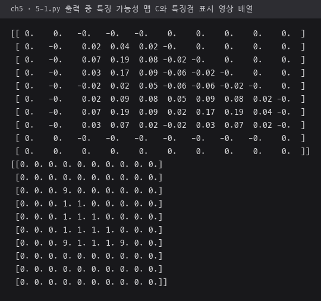
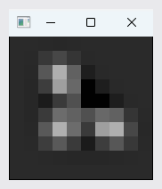
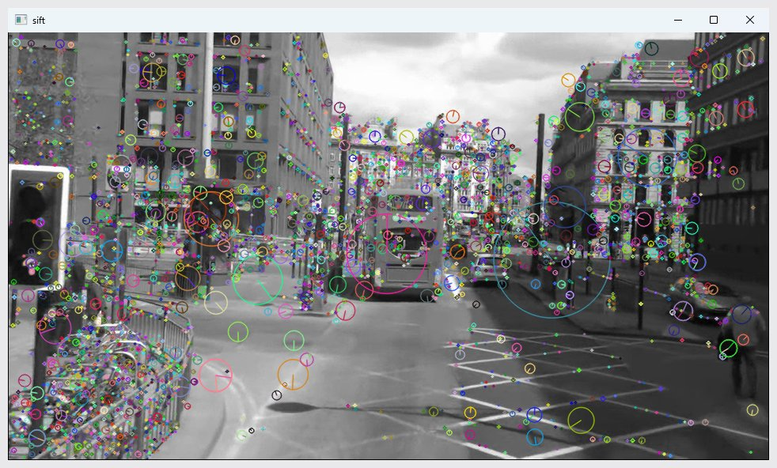
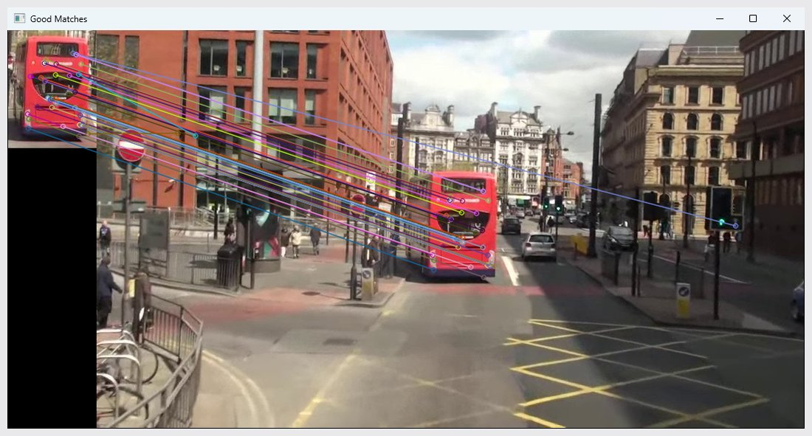
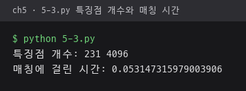
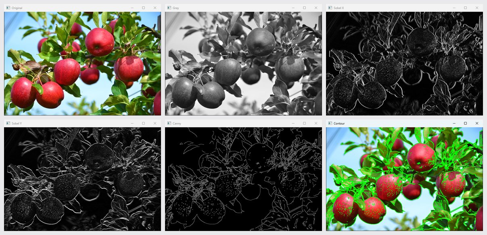
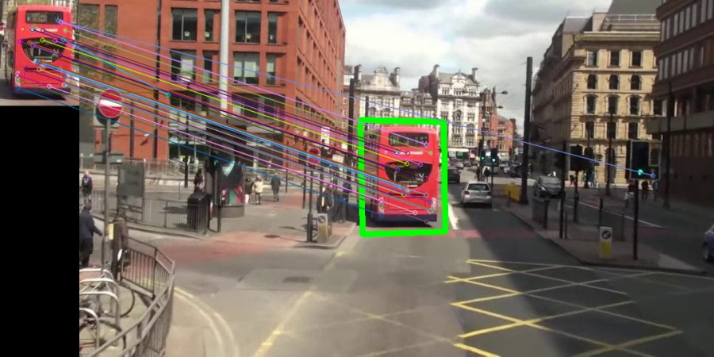
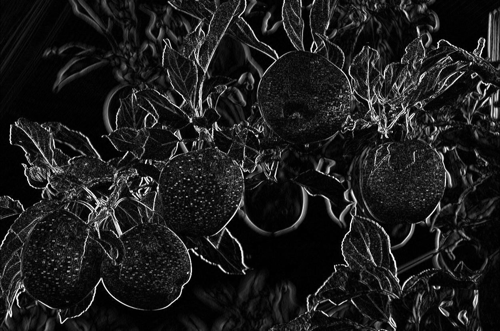
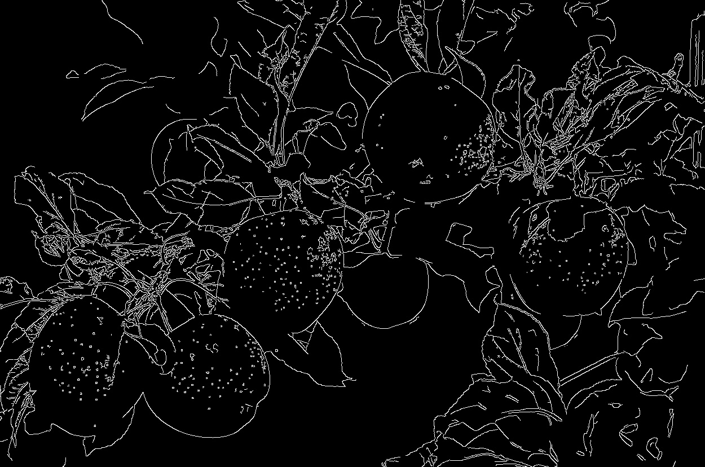
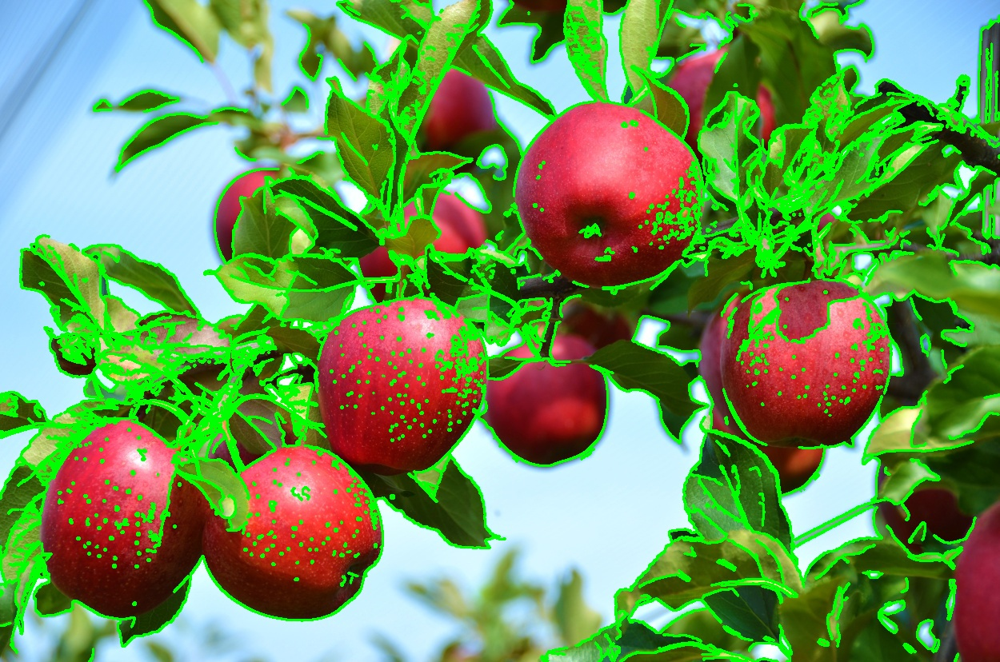

# ch5 · 지역 특징

다른 영상에서도 다시 찾을 수 있는 특징점을 검출하고, 두 영상의 특징점을 짝지은 뒤 호모그래피로 물체 위치를 찾는 처리. 해리스 특징점, SIFT, FLANN 매칭, RANSAC 호모그래피 구현.

## 다룬 개념

| 개념 | 뜻과 사용 방법 |
|---|---|
| 특징점 | 모서리처럼 주변과 뚜렷이 구별되어 시점이 바뀐 다른 영상에서도 다시 찾을 수 있는 점 |
| 해리스 특징 가능성 맵 | 가로·세로 미분의 곱을 가우시안으로 평균 낸 값으로 각 화소가 모서리일 가능성을 계산한 맵. `cv.filter2D`로 미분 필터와 가우시안 필터를 적용해 작은 배열에서 단계별 계산 |
| 비최대 억제 | 이웃보다 큰 값만 남겨 특징점이 한 점으로 모이게 하는 처리. 가능성 값이 0.1보다 크고 주변 8개 화소보다 큰 화소만 특징점으로 표시 |
| SIFT | 영상 크기와 회전이 바뀌어도 같은 점을 찾도록 만든 특징점 검출·기술 방법. 특징점마다 주변 기울기 분포를 기술자 벡터로 표현. `cv.SIFT_create`, `detectAndCompute`, `cv.drawKeypoints` |
| 특징점 매칭 | 두 영상의 기술자 거리를 비교해 같은 점끼리 짝짓는 처리. FLANN은 근사 최근접 이웃 탐색으로 짝을 빠르게 찾는 매처. 최근접 2개의 거리 비율이 0.7 미만인 짝만 남기는 비율 검사 적용. `cv.DescriptorMatcher_create`, `knnMatch` |
| 호모그래피 | 한 평면을 다른 시점에서 본 평면으로 옮기는 3×3 투영 변환 행렬. RANSAC은 무작위로 고른 짝으로 변환을 반복 추정해 잘못된 짝의 영향을 줄이는 방법. `cv.findHomography`에 `cv.RANSAC` 지정, `cv.perspectiveTransform`으로 모델 영상의 네 꼭짓점을 장면에 투영 |
| 에지와 윤곽선 저장 | 4장의 소벨·캐니 에지와 윤곽선 추출을 사과 사진에 적용하고 결과 영상을 파일로 저장. `cv2.Sobel`, `cv2.Canny`, `cv2.findContours`, `cv2.imwrite` |

## 파일별 내용

| 파일 | 내용 | 핵심 코드 |
|---|---|---|
| [5-1.py](5-1.py) | 삼각형 모양 작은 배열에서 미분, 가우시안 평균, 해리스 특징 가능성 맵을 단계별 출력, 특징점을 9로 표시하고 맵을 확대 영상으로 표시 | `cv.getGaussianKernel`, `np.outer`, `cv.filter2D` |
| [5-2.py](5-2.py) | 거리 영상에서 SIFT 특징점 검출, 크기와 방향을 원으로 표시 | `cv.SIFT_create`, `detectAndCompute`, `DRAW_MATCHES_FLAGS_DRAW_RICH_KEYPOINTS` |
| [5-3.py](5-3.py) | 한 프레임에서 버스 영역을 잘라 모델 영상으로 두고 다른 프레임과 FLANN 매칭, 비율 검사를 통과한 짝 표시 | `knnMatch`, `cv.drawMatches` |
| [5-4.py](5-4.py) | 5-3의 매칭 결과로 RANSAC 호모그래피를 구해 장면 속 버스 위치를 초록 사각형으로 표시 | `cv.findHomography`, `cv.perspectiveTransform`, `cv.polylines` |
| [import cv2.py](import%20cv2.py) | 사과 사진의 소벨 x·y, 캐니, 바깥 윤곽선 결과를 0.5배로 표시하고 원래 크기로 파일 저장 | `cv2.Sobel`, `cv2.Canny`, `cv2.findContours`, `cv2.imwrite` |

`mot_color70.jpg`, `mot_color83.jpg`: 버스가 지나가는 거리 영상의 두 프레임. `apples.jpg`: 사과 사진. `sobelx.jpg`, `sobely.jpg`, `canny.jpg`, `contour.jpg`: `import cv2.py`가 저장한 결과 영상.

## 실행 결과

Python 3.11, OpenCV 4.13.0으로 실행한 화면. OpenCV 창은 Win32 `PrintWindow`로 창 그대로 찍은 사진.

| 해리스 `5-1.py` 출력 끝부분. 특징 가능성 맵 `C`와 특징점을 9로 표시한 배열 | `5-1.py`가 띄운 확대 영상 창 |
|---|---|
|  |  |

| SIFT 특징점 `5-2.py`. 원 크기는 스케일, 선은 방향 | FLANN 매칭과 비율 검사 `5-3.py` |
|---|---|
|  |  |

| `5-3.py`가 출력한 두 영상 특징점 개수와 매칭 시간 | `import cv2.py` 표시 창. 원본, 명암, 소벨 X·Y, 캐니, 윤곽선 |
|---|---|
|  |  |

SIFT 매칭과 호모그래피 `5-4.py`. 왼쪽 위가 모델로 쓴 버스 영역, 초록 사각형이 장면에서 찾은 위치.

사과 에지·윤곽선 `import cv2.py` 저장 결과.

| 소벨 X | 캐니 | 윤곽선 |
|---|---|---|
|  |  |  |
