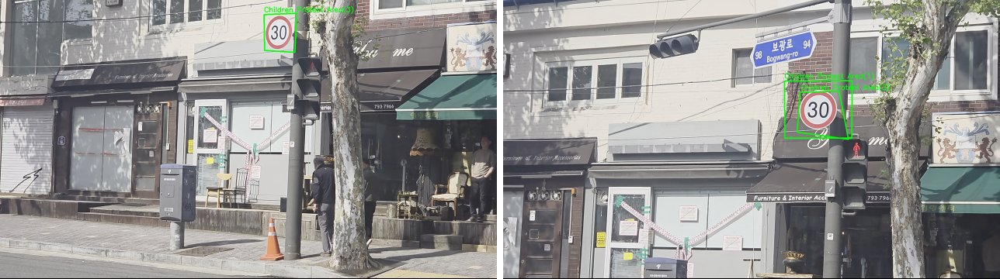

# ch6 · PyQt5 비전 응용

PyQt5 버튼 창에 OpenCV 처리를 연결한 응용 프로그램. 프레임 저장, GrabCut 오림, 교통약자 표지판 인식, 파노라마 봉합, 사진·비디오 특수 효과, 도로 영상 속 어린이보호구역 속도 표지판 검출 구현.

소스와 영상은 하위 폴더 [ch6/](ch6)에 위치.

## 다룬 개념

| 개념 | 뜻과 사용 방법 |
|---|---|
| PyQt5 창과 버튼 콜백 | 버튼·라벨 같은 GUI 화면을 만드는 Qt의 파이썬 라이브러리. `QMainWindow`를 상속해 창을 만들고 `QPushButton.clicked.connect`로 버튼마다 처리 함수 연결 |
| 파일 대화 상자 | 사용자가 열거나 저장할 파일을 고르는 창. `QFileDialog.getOpenFileName`, `QFileDialog.getSaveFileName` |
| GrabCut 오림 | 물체·배경으로 칠한 표시를 바탕으로 물체만 오려 내는 대화형 분할. 파일 열기, 붓 칠, 오림, 붓 크기 조절, 저장을 버튼 흐름으로 연결. `cv.grabCut` |
| 특징점 매칭 표지판 인식 | 등록한 표지판 영상과 도로 영상의 SIFT 특징을 매칭해 짝이 가장 많은 표지판을 고르고 호모그래피로 위치를 찾는 방법. 짝이 4개 미만이면 표지판 없음으로 판정 |
| 파노라마 봉합 | 겹치는 부분이 있는 여러 사진을 특징 매칭으로 정렬해 한 장의 넓은 영상으로 잇는 처리. `cv.Stitcher_create`, `stitch` 반환 상태 `cv.STITCHER_OK` 검사 |
| 사진 특수 효과 | 영상을 그림처럼 바꾸는 필터. 엠보싱 `cv.filter2D`, 카툰 `cv.stylization`, 연필 스케치 `cv.pencilSketch`, 유화 `cv.xphoto.oilPainting` |
| CLAHE | 영상을 작은 타일로 나눠 타일마다 히스토그램 평활화를 하되 대비 증폭에 한도를 두는 방법. 프레임 매칭 전 명암 대비 보정에 사용. `cv2.createCLAHE` |
| BFMatcher와 비율 검사 | 모든 기술자 쌍의 거리를 하나씩 비교하는 전수 탐색 매처. 최근접 거리가 두 번째 거리의 0.75배 미만인 짝만 사용. `cv2.BFMatcher(cv2.NORM_L2)`, `knnMatch(k=2)` |
| 인라이어 비율 | RANSAC으로 구한 호모그래피에 들어맞는 짝의 비율. 비율이 낮으면 우연히 맞은 매칭으로 보고 제외 |
| QTimer 프레임 재생 | 정해진 간격마다 함수를 호출하는 Qt 타이머. 호출마다 비디오 프레임을 읽어 `QImage`, `QPixmap`으로 바꿔 라벨에 표시 |

## 파일별 내용

| 파일 | 내용 | 핵심 코드 |
|---|---|---|
| [6-1.py](ch6/6-1.py) | 버튼으로 짧은·긴 삑 소리를 내고 라벨 문구를 바꾸는 창 | `QPushButton`, `clicked.connect`, `winsound.Beep` |
| [6-2.py](ch6/6-2.py) | 웹캠 켜기, 프레임 잡기, 잡은 프레임 파일 저장 버튼 | `cv.VideoCapture`, `QFileDialog.getSaveFileName`, `cv.imwrite` |
| [6-3.py](ch6/6-3.py) | 사진을 열어 마우스로 물체·배경을 칠하고 GrabCut으로 오린 뒤 저장, `+`·`-` 버튼으로 붓 크기 조절 | `cv.setMouseCallback`, `cv.grabCut` |
| [6-4.py](ch6/6-4.py) | 어린이·노인·장애인 표지판을 등록하고 도로 사진에서 가장 많이 매칭된 표지판을 찾아 위치 표시와 서행 안내 문구 출력 | `cv.SIFT_create`, `knnMatch`, `cv.findHomography` |
| [6-5.py](ch6/6-5.py) | 웹캠에서 `c` 키로 영상을 모아 파노라마로 봉합, 실패 시 경고음과 안내 문구 | `cv.Stitcher_create`, `cv.STITCHER_OK` |
| [6-6.py](ch6/6-6.py) | 사진에 엠보싱·카툰·연필 스케치·유화 효과를 적용하고 콤보 상자에서 고른 결과 저장 | `cv.stylization`, `cv.pencilSketch`, `cv.xphoto.oilPainting` |
| [6-7.py](ch6/6-7.py) | 6-6과 같은 효과를 웹캠 영상에 실시간 적용, 콤보 상자로 효과 전환 | `QComboBox.currentIndex`, `cv.VideoCapture` |
| [CPA_detection.py](ch6/CPA_detection.py) | 도로 동영상에서 어린이보호구역 속도 30 표지판 검출. 템플릿 세 장과 프레임을 SIFT로 매칭하고 조건을 통과한 위치에 사각형과 이름 표시 | `cv2.createCLAHE`, `cv2.BFMatcher`, `cv2.findHomography`, `QTimer` |
| [test.py](ch6/test.py) | `CPA_detection.py`와 같은 내용 | `SchoolZoneDetector` |
| [123123123.py](ch6/123123123.py) | 속도 30 표지판 검출의 단순한 구성. 템플릿 세 장 SIFT 매칭, 비율 0.8 검사, 인라이어 4개 초과 시 사각형 표시, 한 프레임씩 건너뛰며 재생 | `cv2.BFMatcher`, `cv2.findHomography`, `CAP_PROP_POS_FRAMES` |
| [tetris in py.py](ch6/tetris%20in%20py.py) | PyQt5 테트리스 게임. 블록 이동·회전, 줄 지우기, 점수·레벨, 착지 위치 미리 보기 | `QPainter.fillRect`, `QTimer`, `zip(*shape[::-1])` |

`child.png`, `elder.png`, `disabled.png`: 6-4 표지판 모델 영상. `speed30.png`, `speed30_B.png`, `speed30_C.png`: 속도 30 표지판 템플릿. `traffic1.jpg`~`traffic8.jpg`: 6-4에서 불러오는 표지판 장면 사진.

## 표지판 검출 조건 CPA_detection.py

| 단계 | 처리 |
|---|---|
| 템플릿 준비 | 긴 변 300 화소 이하로 축소, SIFT 기술자 미리 계산 |
| 프레임 준비 | 0.5배 축소, CLAHE 대비 보정, 세 프레임마다 한 번 검출 |
| 매칭 | 비율 0.75 검사, 좋은 짝 8개 미만 제외 |
| 호모그래피 | RANSAC 추정, 인라이어 5개 미만 또는 인라이어 비율 0.4 미만 제외 |
| 사각형 검사 | 투영 사각형의 면적 범위, 볼록 꼭짓점 4개, 가로세로 비율 0.3~3.0 조건 확인 |
| 표시 | 원래 크기 좌표로 되돌려 사각형과 라벨 표시, 상태 줄에 검출 이름 출력 |

## 실행 결과

`CPA_detection.py`의 검출 함수 `detect_signs`를 도로 영상 프레임에 적용한 결과.

도로 동영상은 저장소에 없어 실행 전 별도 준비. `123123123.py`는 스크립트 폴더의 `20260429_road.mp4`를 열고, `CPA_detection.py`는 파일 대화 상자로 동영상 선택.
