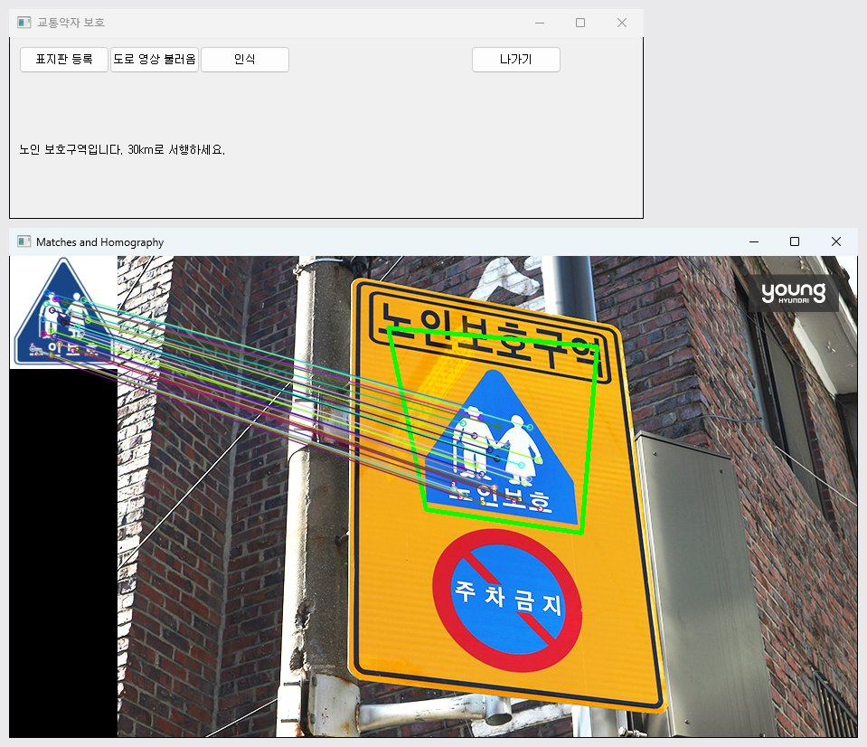
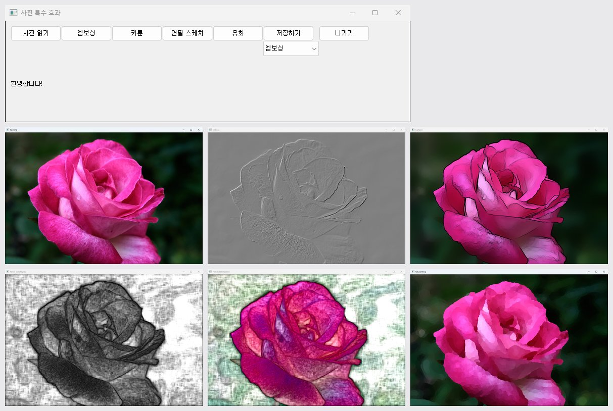

# ch6 · PyQt5 비전 응용 소스

6장 PyQt5 비전 응용 예제, 어린이보호구역 표지판 검출 과제, 표지판 템플릿과 도로 사진 폴더. 개념 설명, 검출 조건, 실행 결과는 상위 폴더 [ch6 README](../README.md)에 정리.

## 소스 파일

| 파일 | 역할 |
|---|---|
| [6-1.py](6-1.py) | 버튼으로 짧은·긴 삑 소리를 내는 창 |
| [6-2.py](6-2.py) | 웹캠 프레임 잡기와 파일 저장 |
| [6-3.py](6-3.py) | 마우스 붓 칠과 GrabCut 오림 |
| [6-4.py](6-4.py) | SIFT 매칭 교통약자 표지판 인식과 서행 안내 |
| [6-5.py](6-5.py) | 웹캠 영상을 모아 파노라마 봉합 |
| [6-6.py](6-6.py) | 사진 엠보싱·카툰·연필 스케치·유화 효과 |
| [6-7.py](6-7.py) | 웹캠 영상 실시간 특수 효과 |
| [CPA_detection.py](CPA_detection.py) | 도로 동영상 속 어린이보호구역 속도 30 표지판 검출 과제 |
| [test.py](test.py) | `CPA_detection.py`와 같은 내용 |
| [123123123.py](123123123.py) | 속도 30 표지판 검출의 단순한 시험본 |
| [tetris in py.py](tetris%20in%20py.py) | PyQt5 테트리스 게임 |

## 영상 파일

| 파일 | 역할 |
|---|---|
| `child.png`, `elder.png`, `disabled.png` | `6-4` 어린이·노인·장애인 표지판 모델 영상 |
| `speed30.png`, `speed30_B.png`, `speed30_C.png` | `CPA_detection.py`, `123123123.py` 속도 30 표지판 템플릿 |
| `traffic1.jpg`~`traffic8.jpg` | `6-4`에서 파일 대화 상자로 여는 도로 장면 사진 |

## 실행 방법

영상 파일을 스크립트 폴더 기준으로 읽으므로 이 폴더에서 실행.

```bash
pip install opencv-contrib-python numpy PyQt5
cd PRG_CV/ch6/ch6
python 6-4.py
```

- `6-1`, `6-4`, `6-5`: 소리 출력에 `winsound` 사용, Windows 전용.
- `6-6`, `6-7`: 유화 효과 `cv.xphoto`에 `opencv-contrib-python` 필요.
- 도로 동영상은 저장소에 없음. `123123123.py`는 같은 폴더의 `20260429_road.mp4`를 열고, `CPA_detection.py`는 파일 대화 상자로 동영상 선택.

## 실행 결과

이 폴더 예제를 PyQt5 5.15로 실행한 화면 중 일부. 나머지 결과와 실행 방식은 [상위 README](../README.md#실행-결과)에 정리.

| `6-4.py` 노인 표지판 인식, `traffic1.jpg` 입력 | `6-6.py` 엠보싱·카툰·연필 스케치·유화 |
|---|---|
|  |  |
