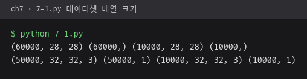
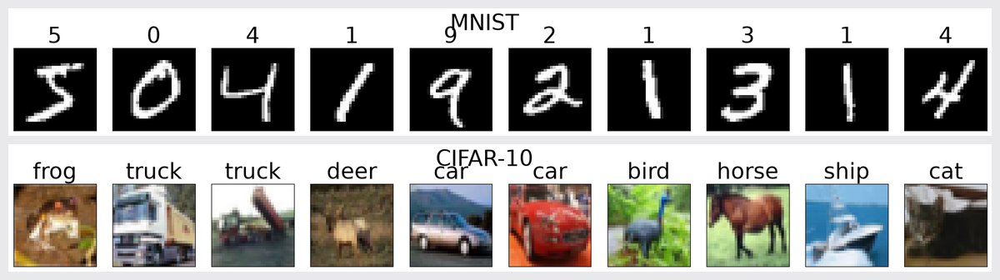
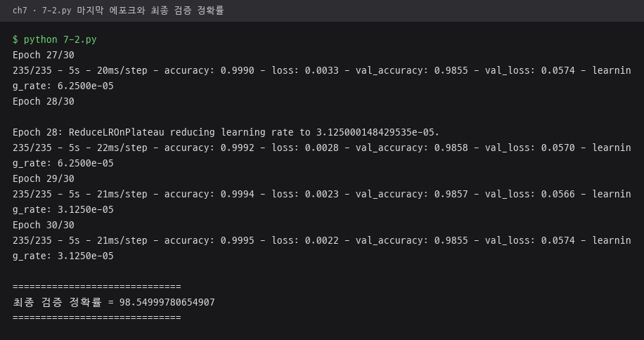
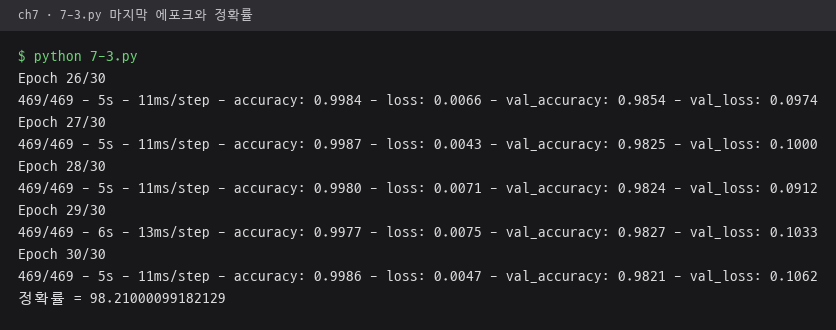
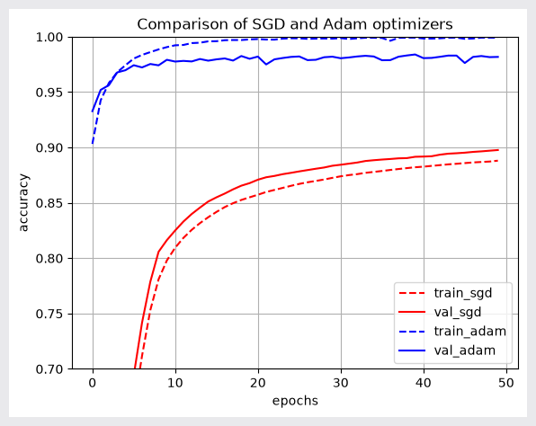
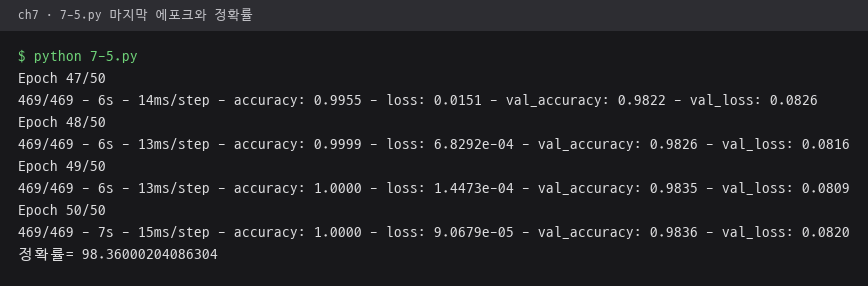
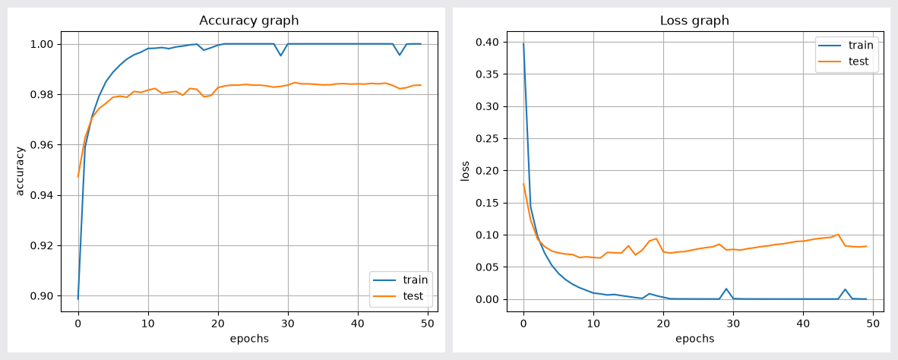
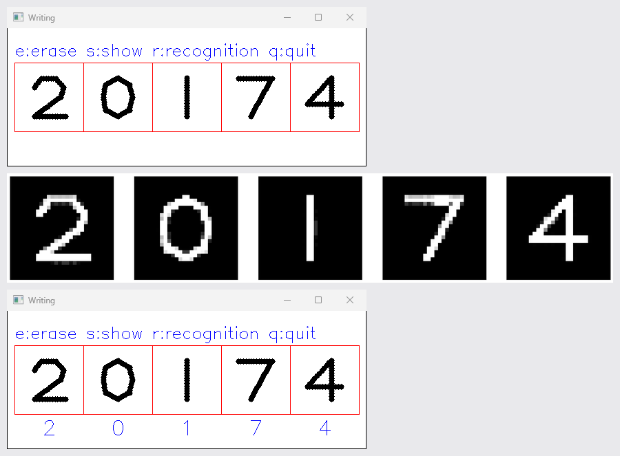
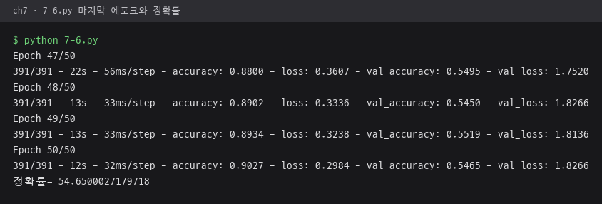
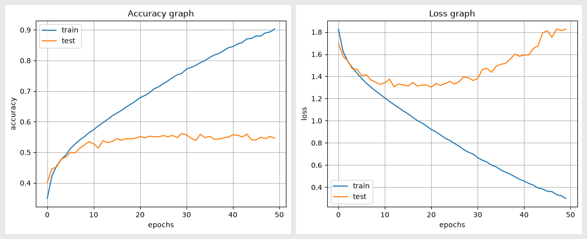

# ch7 · 다층 퍼셉트론

완전연결층을 여러 겹 쌓은 다층 퍼셉트론으로 MNIST 숫자와 CIFAR-10 사진 분류, 학습한 모델로 마우스 필기 숫자 인식 구현.

## 다룬 개념

| 개념 | 뜻과 사용 방법 |
|---|---|
| MNIST·CIFAR-10 | MNIST는 28×28 흑백 손글씨 숫자 데이터셋, CIFAR-10은 32×32 컬러 사진 10부류 데이터셋. `tensorflow.keras.datasets`로 불러와 첫 10장을 정답과 함께 표시 |
| 다층 퍼셉트론 | 이전 층의 모든 값에 가중치를 곱해 더하고 활성 함수를 거치는 완전연결층을 여러 겹 쌓은 신경망. 영상을 784 또는 3072 길이 벡터로 펴서 `Dense` 층에 입력 |
| 활성 함수 | 층 출력에 비선형성을 더하는 함수. 은닉층에 `tanh`, `relu`, 출력층에 부류별 확률을 내는 `softmax` 사용 |
| 원-핫 인코딩 | 정답 번호를 해당 자리만 1이고 나머지는 0인 벡터로 바꾸는 표현. `tf.keras.utils.to_categorical` |
| 손실 함수 | 예측과 정답의 차이를 수치로 나타내는 함수. 평균 제곱 오차 `MSE`와 교차 엔트로피 `categorical_crossentropy` 사용 |
| 옵티마이저 | 손실을 줄이도록 가중치를 고치는 방법. SGD는 기울기 방향으로 일정 비율만큼 이동, Adam은 기울기의 평균과 크기를 함께 반영해 매개변수마다 이동 폭 조절. 같은 모델에 두 방법을 적용해 정확도 곡선 비교 |
| 배치 정규화와 드롭아웃 | 배치 정규화는 층 출력을 미니 배치 단위로 평균 0, 분산 1 근처로 맞춰 학습을 안정시키는 층. 드롭아웃은 학습 중 노드 일부를 무작위로 꺼서 과적합을 줄이는 기법. `BatchNormalization`, `Dropout(0.3)` |
| 학습률 자동 감소 | 검증 손실이 줄지 않을 때 학습률을 낮추는 콜백. `ReduceLROnPlateau`로 3 에포크 정체 시 학습률 절반 적용 |
| 모델 저장과 재사용 | 학습한 구조와 가중치를 파일로 저장한 뒤 다른 프로그램에서 불러 예측에 사용. `dmlp.save('dmlp_trained.h5')`, `tf.keras.models.load_model` |

## 파일별 내용

| 파일 | 내용 | 핵심 코드 |
|---|---|---|
| [7-1.py](7-1.py) | MNIST와 CIFAR-10의 배열 크기 출력, 첫 10장을 정답과 함께 표시 | `ds.mnist.load_data`, `ds.cifar10.load_data` |
| [7-2.py](7-2.py) | 1024·512·256 노드 은닉층마다 배치 정규화와 드롭아웃을 둔 깊은 MLP로 MNIST 분류, 학습률 자동 감소 | `BatchNormalization`, `Dropout`, `ReduceLROnPlateau` |
| [7-3.py](7-3.py) | ReLU 은닉층 두 개, 교차 엔트로피, Adam으로 구성한 MLP로 MNIST 분류 | `Dense(units=1024, activation='relu')`, `Adam` |
| [7-4.py](7-4.py) | 같은 구조의 MLP를 SGD와 Adam으로 각각 학습해 정확도 곡선 비교 | `SGD`, `Adam`, `hist.history` |
| [7-5.py](7-5.py) | 은닉층 세 개의 깊은 MLP로 MNIST 분류, 정확도·손실 그래프 표시 후 모델 저장 | `dmlp.save`, `plt.plot` |
| [7-6.py](7-6.py) | 7-5와 같은 깊은 MLP를 CIFAR-10에 적용 | `ds.cifar10`, `input_shape=(3072,)` |
| [7-7.py](7-7.py) | 마우스로 다섯 칸에 숫자를 쓰고 `r` 키로 저장 모델의 인식 결과 표시, `e` 키 지우기, `s` 키로 잘라 낸 숫자 보기 | `load_model`, `cv.setMouseCallback`, `model.predict` |

`7-7.py`는 `7-5.py`가 저장한 `dmlp_trained.h5`를 불러 사용.

## 실행 결과

Python 3.11, TensorFlow 2.21 CPU로 실행한 결과. 학습 로그는 터미널 출력의 연속된 끝부분, 그래프와 영상 목록은 `plt.show` 시점의 figure를 그대로 저장한 사진. MNIST·CIFAR-10은 Keras 데이터셋 캐시 사용.

| MNIST·CIFAR-10 배열 크기 `7-1.py` | 첫 10장과 정답 `7-1.py`. 위 MNIST, 아래 CIFAR-10 |
|---|---|
|  |  |

| 배치 정규화·드롭아웃 깊은 MLP `7-2.py`. 30 에포크, 최종 검증 정확률 98.55 | ReLU·Adam MLP `7-3.py`. 30 에포크, 정확률 98.21 |
|---|---|
|  |  |

| SGD·Adam 정확도 곡선 `7-4.py`. 50 에포크 뒤 SGD 89.77, Adam 98.18 | 깊은 MLP `7-5.py`. 50 에포크, 정확률 98.36 |
|---|---|
|  |  |

`7-5.py` 정확도·손실 그래프.

필기 숫자 인식 `7-7.py`. `7-5.py`가 저장한 `dmlp_trained.h5` 사용. 마우스 콜백에 끌기 이벤트를 넣어 칸마다 2·0·1·7·4를 쓴 화면, `s` 키로 잘라 낸 28×28 숫자, `r` 키 뒤 인식 결과 2·0·1·7·4 순서.

깊은 MLP를 CIFAR-10에 적용한 `7-6.py`. 50 에포크 뒤 정확률 54.65로 MNIST보다 크게 낮은 결과.

| `7-6.py` 마지막 에포크와 정확률 | `7-6.py` 정확도·손실 그래프 |
|---|---|
|  |  |
