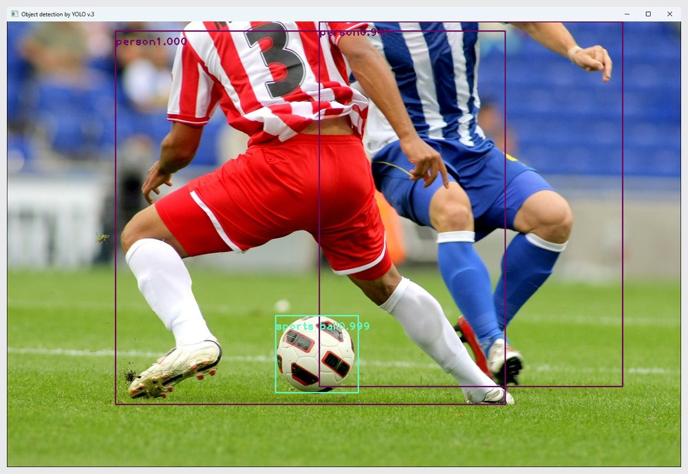

# ch9 · 검출과 분할 소스

9장 YOLO v3 검출, U-net 학습, DeepLabv3 의미 분할, Mask R-CNN 사례 분할, 배경 바꾸기 예제 폴더. 개념 설명과 핵심 코드는 상위 폴더 [ch9 README](../README.md)에 정리.

## 소스 파일

| 파일 | 역할 |
|---|---|
| [9-1.py](9-1.py) | `soccer.jpg` YOLO v3 물체 검출, 부류별 사각형과 신뢰도 표시 |
| [9-2.py](9-2.py) | 9-1 검출을 웹캠 프레임마다 적용 |
| [9-3.py](9-3.py) | 9-2에 초당 프레임 수 측정 추가 |
| [9-4.py](9-4.py) | Oxford Pets U-net 분할 학습, 최고 모델 `oxford_seg.h5` 저장 |
| [9-5.py](9-5.py) | `busy_street.jpg` DeepLabv3 ADE20K 의미 분할 |
| [9-6.py](9-6.py) | 웹캠 의미 분할 결과 표시와 `output_video.mp4` 저장 |
| [9-7.py](9-7.py) | `busy_street.jpg` Mask R-CNN 사례 분할 |
| [9-8.py](9-8.py) | 웹캠 영상에서 사람과 책만 사례 분할 |
| [9-9.py](9-9.py) | PyQt5 창에서 웹캠 속 사람 뒤 배경 흐림·단색 변경 |

## 데이터·설정 파일

| 파일 | 역할 |
|---|---|
| `soccer.jpg`, `busy_street.jpg` | 검출·분할 입력 사진 |
| `coco_names.txt` | YOLO v3 COCO 부류 이름 목록 |
| `yolov3.cfg` | YOLO v3 신경망 구성 파일 |

## 실행 전 준비

모델과 데이터셋은 용량 문제로 저장소에서 제외. 이 폴더에 두고 이 폴더에서 실행.

| 필요 파일 | 사용 예제 |
|---|---|
| `yolov3.weights` | `9-1`~`9-3` |
| `datasets/oxford_pets/` | `9-4` |
| `deeplabv3_xception65_ade20k.h5` | `9-5`, `9-6` |
| `mask_rcnn_coco.h5` | `9-7`, `9-8` |
| `xception_pascalvoc.pb` | `9-9` |

`9-4`는 TensorFlow, `9-5`~`9-9`는 PixelLib 사용. `9-9`는 PyQt5도 필요.

## 실행 결과

YOLO v3 검출 `9-1.py`. `soccer.jpg`에서 사람 1.000·0.941, 공 0.999 검출. `yolov3.weights`는 공식 배포 파일을 내려받아 사용, Python 3.11, OpenCV 4.13.0 `dnn` 모듈로 실행하고 창을 `PrintWindow`로 찍은 사진.

