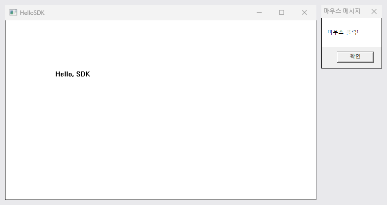

# HelloSDK · Win32 API 창

MFC 없이 Win32 API만으로 창 클래스 등록, 창 생성, 메시지 루프, 창 프로시저를 구성한 Hello 창 구현.

## 다룬 개념

| 개념 | 뜻과 사용 방법 |
|---|---|
| Win32 API | 윈도우 운영체제가 제공하는 C 함수 모음. `windows.h`를 포함하고 `main` 대신 `WinMain`에서 프로그램 시작 |
| 창 클래스 등록 | 창의 모양과 메시지 처리 함수를 `WNDCLASS` 구조체에 채워 운영체제에 등록하는 단계. 흰색 배경, 화살표 커서, 처리 함수 `WndProc`를 지정한 뒤 `RegisterClass` 호출 |
| 창 생성과 표시 | 등록한 클래스 이름으로 실제 창을 만드는 단계. `CreateWindow`로 제목이 `HelloSDK`인 창을 만들고 `ShowWindow`로 표시 |
| 메시지 | 클릭·다시 그리기·닫기 같은 사건을 운영체제가 프로그램에 알리는 값. `WM_PAINT`, `WM_LBUTTONDOWN`, `WM_DESTROY`처럼 `WM_`으로 시작 |
| 메시지 루프 | 메시지 큐에서 메시지를 하나씩 꺼내 창 프로시저로 보내는 반복문. `GetMessage`로 꺼내고 `TranslateMessage`·`DispatchMessage`로 전달, `WM_QUIT`이 오면 종료 |
| 창 프로시저 | 창에 도착한 메시지를 종류별로 처리하는 콜백 함수. `switch (message)`로 분기하고 처리하지 않은 메시지는 `DefWindowProc`에 넘김 |
| 디바이스 컨텍스트 | 화면에 그리기 위한 핸들 `HDC`. `BeginPaint`로 얻어 `TextOut`으로 글자를 쓰고 `EndPaint`로 반납 |

## 동작 흐름

| 사용자 동작 | 메시지 | `WndProc` 처리 |
|---|---|---|
| 프로그램 실행 | `WM_CREATE` | 별도 처리 없이 0 반환 |
| 창이 화면에 그려질 때 | `WM_PAINT` | 창 안 `(100, 100)` 위치에 `Hello, SDK` 출력 |
| 창 안에서 마우스 왼쪽 버튼 클릭 | `WM_LBUTTONDOWN` | `마우스 클릭!` 메시지 상자 표시 |
| 창 닫기 | `WM_DESTROY` | `PostQuitMessage(0)`로 메시지 루프 종료 요청 |

## 파일별 내용

| 파일 | 내용 | 핵심 코드 |
|---|---|---|
| [HelloSDK.cpp](HelloSDK.cpp) | `WinMain`에서 창 클래스 등록·창 생성·메시지 루프 실행, `WndProc`에서 메시지별 처리 | `RegisterClass(&wndclass)`, `CreateWindow`, `while (GetMessage(&msg, NULL, 0, 0) > 0)`, `DefWindowProc` |
| [HelloSDK.slnx](HelloSDK.slnx), [HelloSDK.vcxproj](HelloSDK.vcxproj), [HelloSDK.vcxproj.filters](HelloSDK.vcxproj.filters) | Visual Studio 프로젝트 생성 파일. 하위 시스템 Windows, 유니코드 문자 집합, 플랫폼 도구 집합 v145 | - |

같은 동작을 MFC 클래스로 옮긴 프로젝트는 [HelloMFC](../HelloMFC/README.md).

## 실행 결과

MSYS2 g++ 15.2.0에 `-DUNICODE -D_UNICODE -mwindows` 옵션을 주어 빌드한 실행 화면. 왼쪽은 `(100, 100)` 위치에 `Hello, SDK`를 그린 창, 오른쪽은 창 안에 왼쪽 버튼 클릭 메시지를 보낸 뒤 뜬 `마우스 클릭!` 메시지 상자. 창은 Win32 `PrintWindow`로 찍은 사진.

```bash
g++ -DUNICODE -D_UNICODE -mwindows HelloSDK.cpp -o HelloSDK.exe
```


