# Cpp-CV

C++ 프로그래밍과 OpenCV 컴퓨터 비전 학습 저장소. 작성자 서지섭.

| 폴더 | 내용 | 언어·도구 |
|---|---|---|
| `PRG_C/` | 장별 C++ 문법 예제 | C++, g++ |
| `PRG_CV/` | 장별 OpenCV·딥러닝 비전 예제 | Python, OpenCV |
| `PRG_MFC2/` | Win32 SDK·MFC 윈도우 프로그래밍 | C++, Visual Studio |
| `docs/images/` | README용 실행 결과 이미지 |

`PRG_C`의 소스는 모두 `.cpp`이며 `iostream`, `cout`, 클래스를 쓰는 C++ 코드.

---

## PRG_C 장별 예제

| 장 | 파일 | 주제 | 핵심 개념 |
|---|---|---|---|
| 2장 | `hello.cpp`, `Prg2-1~2`, `prg2-3.cpp` | 프로그램 구조 | `main`, `cout`, `cin`, 두 수 합 |
| 2장 과제 | `Homework.cpp` | 성장 비전 리포트 | `string` 입력, `double` 형 변환으로 달성률 계산, 상태 문자열 분기 |
| 계산기 | `Calc.cpp` | 숫자 4개·연산자 3개 계산 | 곱셈·나눗셈 우선 처리, `long long` 중간값, `INT_MAX` 범위 검사, `bitset<32>`·`hex` 출력 |
| 3장 | `Chap03/Prg3-1~31` | 표현식과 자료형 | 리터럴, 연산자 우선순위·결합 방향, 복합 할당, 암묵적·명시적 형 변환, `typeid`, 정수·실수 오버플로우, `boolalpha`·`oct`·`hex`·`setw`·`setprecision` 조정자 |
| 3장 | `Chap03/clock.cpp` | 초를 일·시·분·초로 변환 | `/`, `%` 연산 연쇄 |
| 4장 | `Chap04/Prg4-1~17` | 선택문 | `if-else` 중첩, 다중 분기 학점, 논리 연산 윤년 판정, `switch` 낙하 실행, 조건 연산자, 누진 세율 계산, 누적 일수 계산 |
| 5장 | `Chap05/Prg5-1~22` | 반복문 | 카운터·센티넬·EOF 제어 `while`, `ifstream` 파일 합계, `do-while` 입력 검증, 중첩 반복 달력·곱셈표, 소수 판정, 팩토리얼, 거듭제곱 오버플로우 검사 |
| 5장 | `Chap05/all.cpp`, `any.cpp`, `homework.cpp` | 전체·존재 조건 판정 | 플래그 초기값 `true`·`false` 차이로 all·any 구현 |
| 6장 | `Chap06/Prg6-1~27` | 함수 | `<cmath>`·`<cctype>`·`<ctime>` 라이브러리, `rand`·`srand` 추측 게임, 값 전달과 참조 전달, 기본 매개변수, 오버로딩, 셰도잉, 범위 해결 연산자, `static` 지역 변수, 예금 미래 가치 |
| 6장 | `Chap06/Prg.cpp` | 구구단 가로 출력, `static` 지역 변수 | 중첩 반복, 정적 지역 변수 누적 |
| 7장 | `Chap07/Prg7-1~15` | 클래스 | 생성자·복사 생성자·소멸자, 접근자·설정자, `static` 객체 수, `assert` 불변 조건, 인터페이스·구현·애플리케이션 파일 분리 |
| 7장 | `Chap07/circle.h`, `circle.cpp`, `app.cpp`, `makefile` | Circle 분할 컴파일 | 헤더 가드, `makefile` 패턴 규칙 |
| 7장 | `Chap07/fraction.h`, `fraction.cpp`, `app2.cpp` | Fraction 분할 컴파일 | 최대공약수 약분, 부호 정규화, 기본 인수 |
| 8장 | `Chap08/Chap08/Prg8-1~15` | 배열 | 배열 역순 출력, 파일 입출력, 객체 배열, 배열 매개변수, 병렬 배열, 2차원 배열, 빈도 배열 히스토그램, 2차원·1차원 선형 변환 |
| 9장 | `Chap09/Prg9-1~21` | 참조·포인터·동적 메모리 | 참조 변수, 포인터 전달 스왑, 포인터 산술, 2차원 배열 포인터 전달, 힙 배열, 래기드 배열 이항계수, 소멸자에서 힙 해제, Matrix 클래스 덧셈·뺄셈·곱셈 |
| 과제 6 | `HW6/product.h`, `product.cpp`, `app.cpp` | 제품 등록 수 관리 | `static` 멤버 변수·함수로 전체 개수 관리, 생성자 증가·소멸자 감소, 블록 종료 시 소멸 시점 확인, `assert` 가격 검증 |

### PRG_C 구현 방식

- 예제 파일은 한 파일에 입력, 처리, 출력 순서로 작성. 주석 머리말에 예제 목적 기재.
- `Calc.cpp`: 숫자 4개와 연산자 3개를 배열로 정리한 뒤, `*`·`/`를 왼쪽부터 먼저 계산해 두 숫자를 하나로 합치고 남은 `+`·`-`를 왼쪽부터 적용. 결과를 `long long`으로 받아 `int` 범위를 넘으면 오버플로우로 처리. 2진수·10진수·16진수 동시 출력.
- `HW6`: `Product::totalCount`를 클래스 전체가 공유하는 정적 멤버로 두고, 생성자와 소멸자에서 증감. 중괄호 블록 안의 객체가 블록 종료 시점에 소멸하는 순서를 출력으로 확인.
- `Chap07`, `Chap08`, `Chap09`의 클래스 예제는 헤더, 구현, 애플리케이션 파일을 분리하는 구조. 분할 예제의 번호 파일은 `circle.h`, `fraction.h`, `student.h`, `course.h`, `matrix.h`, `time.h` 중 하나에 해당하는 코드 조각.

---

## PRG_CV 예제

### 2~6장 영상 처리 기초

| 장 | 파일 | 주제 | 핵심 개념 |
|---|---|---|---|
| 기초 | `hello.py`, `CV.py`, `img2.py`, `cam.py` | NumPy 배열, 영상 표시, 축소·명암 변환, 웹캠 | `np.array.sort`, `cv.imread`, `cv.resize`, `cv.VideoCapture` |
| 과제 2 | `Homework2.py`, `Homework2_2.py` | 산토리니 사진 축소·명암·날짜 표기 | `cv.cvtColor`, 0.5배 축소, `cv.rectangle`, `cv.putText` |
| 2장 | `ch2/2-1~9` | OpenCV 입출력과 마우스 | 영상 저장, 프레임 수집 후 `np.hstack` 연결, 도형·글씨 그리기, 마우스 콜백 사각형·붓 칠 |
| 3장 | `ch3/3-1~9`, `3-8-1` | 화소 처리 | 채널 분리, 히스토그램, 오츄 이진화, 팽창·침식·닫기, 감마 보정, 히스토그램 평활화, 가우시안 스무딩, 엠보싱, 보간법 비교, 회전 변환, 반복문과 벡터 연산 속도 비교 |
| 4장 | `ch4/4-1~3` | 에지와 윤곽선 | 소벨 에지 강도, 캐니 임곗값 비교, `findContours` 길이 필터 |
| 4장 | `ch4/4-4.py` | 사과 검출·개수 세기 | HSV 빨강 두 구간 마스크, 모폴로지 열기·닫기, 면적·원형도 필터, `minEnclosingCircle` |
| 4장 | `ch4/4-5~8`, `4-6.py` | 영역 분할과 형상 | SLIC 슈퍼픽셀, 정규화 절단, GrabCut, 모멘트·면적·둘레·둥근 정도, 직선 근사, 볼록 헐 |
| 5장 | `ch5/5-1~4` | 지역 특징 | 해리스 특징 가능성 맵과 비최대 억제, SIFT 키포인트, FLANN 최근접 2개 비율 검사, RANSAC 호모그래피 |
| 5장 | `ch5/import cv2.py` | 사과 사진 에지·윤곽선 저장 | 소벨 X·Y, 캐니, 외곽 윤곽선, 결과 파일 저장 |
| 6장 | `ch6/ch6/6-1~7` | PyQt5 비전 응용 | 버튼 콜백, 프레임 수집·저장, GrabCut 오림, SIFT 교통약자 표지판 인식, 파노라마 봉합, 엠보싱·카툰·연필 스케치·유화 효과 |
| 6장 과제 | `ch6/ch6/CPA_detection.py` | 도로 영상 어린이보호구역 속도 30 표지판 검출 | SIFT, BFMatcher 비율 검사, RANSAC 인라이어 비율, 검출 사각형 유효성 검사, `QTimer` 프레임 재생 |
| 6장 | `ch6/ch6/123123123.py`, `test.py` | 표지판 검출 시험본 | `test.py`는 `CPA_detection.py`와 같은 내용 |
| 6장 | `ch6/ch6/tetris in py.py` | PyQt5 테트리스 | `QPainter` 블록 그리기, `QTimer` 낙하, 행렬 회전 |

### 7~13장 딥러닝 비전

| 장 | 파일 | 주제 | 핵심 개념 |
|---|---|---|---|
| 7장 | `ch7/7-1~7` | 다층 퍼셉트론 | MNIST·CIFAR-10 확인, SGD·Adam 비교, 깊은 MLP, 배치 정규화·드롭아웃, 학습 모델 저장 후 필기 숫자 인식 |
| 8장 | `ch8/8-1~8` | 컨볼루션 신경망 | LeNet-5, CIFAR-10 CNN, 데이터 증대, ResNet50 사전 학습 분류, DenseNet121 전이 학습 견종 분류, PyQt5 견종 인식 앱 |
| 9장 | `ch9/ch9/9-1~9` | 검출과 분할 | YOLO v3 정지 영상·비디오 검출과 FPS 측정, U-net Oxford Pets 분할, DeepLabv3·Mask R-CNN 분할, 배경 흐림·색 변경 |
| 10장 | `ch10/10-1~9` | 추적과 사람 인식 | Farneback·Lucas-Kanade 광류, YOLO v3와 SORT 사람 추적, MediaPipe 얼굴 검출·증강 현실·얼굴 그물망·손·자세 |
| 10장 | `ch10/test.py` | 손가락 그림판 | MediaPipe 손 랜드마크, 검지만 펴면 그리기, 검지·중지를 펴면 색 선택·지우기, 캔버스 마스크 합성 |
| 11장 | `ch11/11-1~5` | 트랜스포머 | CIFAR-10 ViT 직접 구현, Hugging Face ViT 분류, DETR 검출, CLIP 영상-문장 유사도 |
| 12장 | `ch12/12-1~2` | 3차원 비전 | ModelNet10 점 구름 시각화, PointNet 분류 |
| 13장 | `ch13/13-1~8` | 생성 모델 | 가우시안 샘플 생성, 가우시안 혼합, 오토인코더, VAE, Fashion-MNIST·CIFAR-10 DCGAN, Stable Diffusion |

### PRG_CV 구현 방식

- `ch4/4-4.py`: 빨강이 HSV 색상 양 끝에 걸치므로 0~10, 160~180 두 구간 마스크를 더함. 닫기·열기로 구멍과 잡음 제거 후 면적 2000 미만, 원형도 0.7 이하, 반지름 30 이하 윤곽선 제외.
- `CPA_detection.py`: 템플릿 3장을 긴 변 300 화소 이하로 줄이고 SIFT 기술자 미리 계산. 프레임은 0.5배 축소, CLAHE 대비 보정 후 매칭. 좋은 매칭 8개 미만, 인라이어 5개 미만, 인라이어 비율 0.4 미만이면 제외. 투영된 사각형의 면적, 볼록 꼭짓점 4개, 가로세로 비율 0.3~3.0 조건을 통과한 경우만 표시.
- `ch5/5-4.py`: 버스 영역을 잘라 모델 영상으로 쓰고 다른 프레임에서 같은 버스 위치를 호모그래피로 찾음. 최근접 거리 비율 0.7 미만 매칭만 사용.

---

## PRG_MFC2 윈도우 프로그래밍

Visual Studio `.slnx` 솔루션, 플랫폼 도구 집합 v145. `HelloSDK`를 제외한 프로젝트는 MFC 동적 연결.

| 프로젝트 | 주제 | 핵심 개념 |
|---|---|---|
| `HelloSDK` | Win32 API 창 | `WNDCLASS` 등록, `CreateWindow`, 메시지 루프, `WndProc`의 `WM_PAINT`·`WM_LBUTTONDOWN` |
| `HelloMFC` | 최소 MFC 창 | `CWinApp`·`CFrameWnd` 상속, 메시지 맵 |
| `Console` | MFC 콘솔 | `AfxWinInit`, 문자열 리소스 `LoadString` |
| `App` | MDI 마법사 프로젝트 | 문서·뷰 구조, 도킹 창 |
| `Button`, `Button1` | 버튼 컨트롤 | `CButton::Create`로 푸시·체크·3상태·라디오·그룹 박스 생성, `GetCheck` 상태를 메시지 상자로 출력 |
| `Diaglosbase` | 대화 상자 | `CColorDialog`로 고른 색의 RGB·HEX 값 출력 |
| `WebCamViewer` | MFC 웹캠 뷰어와 YOLO 검출 | `SetTimer` 33ms 프레임 갱신, Picture Control에 DIB 출력, 별도 스레드에서 `readNetFromONNX`·`NMSBoxes` 추론, 화면 FPS 표시 |

---

## 실행 결과

C++ 결과는 MSYS2 g++ 15.2.0으로 다시 컴파일·실행한 출력을 터미널 모양 이미지로 만든 것. 입력값은 노란색 표시. OpenCV 결과는 Python 3.14, OpenCV 4.13.0으로 코드를 실행하고 `imshow` 창 대신 파일로 저장한 것. `CPA_detection.py`는 PyQt5 화면 없이 검출 함수 `detect_signs`만 프레임마다 호출한 결과.

### C++

| 달력 출력 `Prg5-11` | 빈도 히스토그램 `Prg8-14` |
|---|---|
| 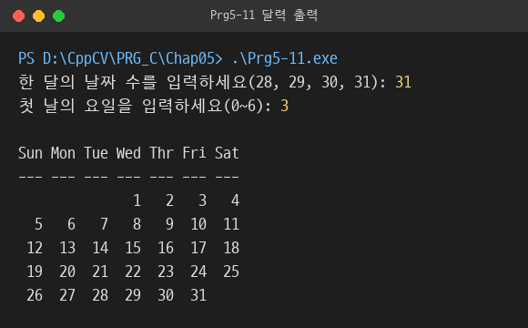 | 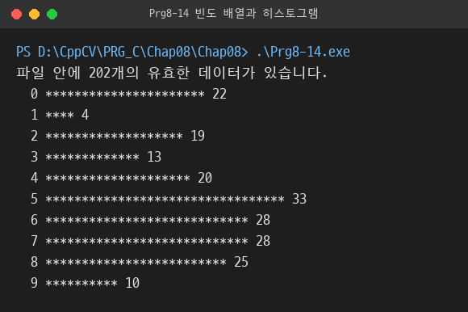 |

| 정적 멤버와 소멸 시점 `HW6` | Fraction 분할 컴파일 `Chap07` |
|---|---|
| 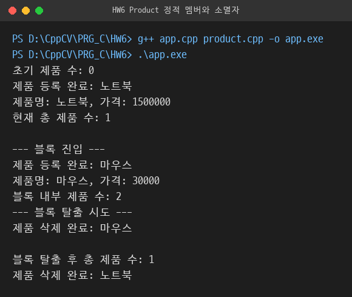 | 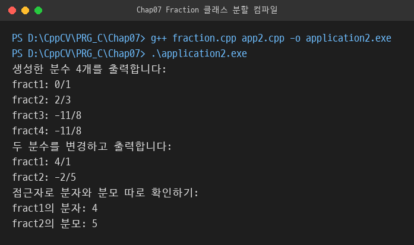 |

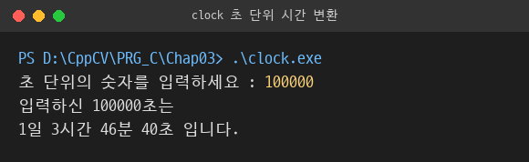

### OpenCV

과제 2 결과. 0.5배 축소 후 날짜 표기, 저장소에 있던 결과 파일.


오츄 이진화 `ch3/3-3.py`. R 채널과 이진화 결과, 찾은 임곗값 113.


캐니 임곗값 비교 `ch4/4-2.py`. 왼쪽 50·150, 오른쪽 100·200.

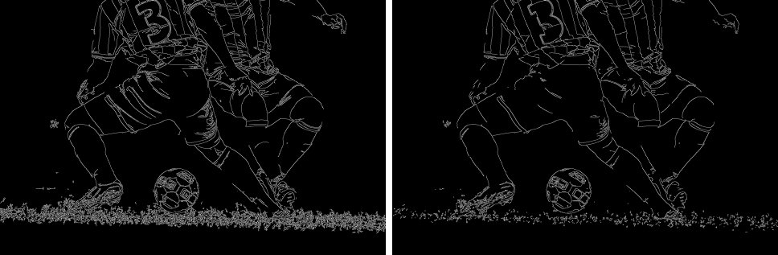

사과 에지·윤곽선 `ch5/import cv2.py`. 저장소에 있던 결과 파일.

| 소벨 X | 캐니 | 윤곽선 |
|---|---|---|
| 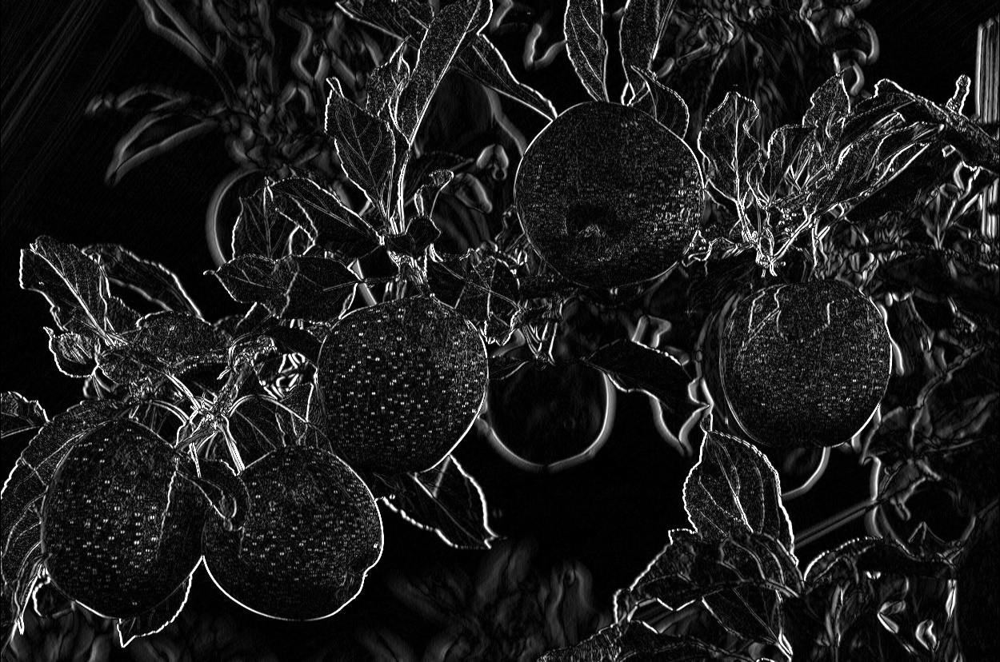 | 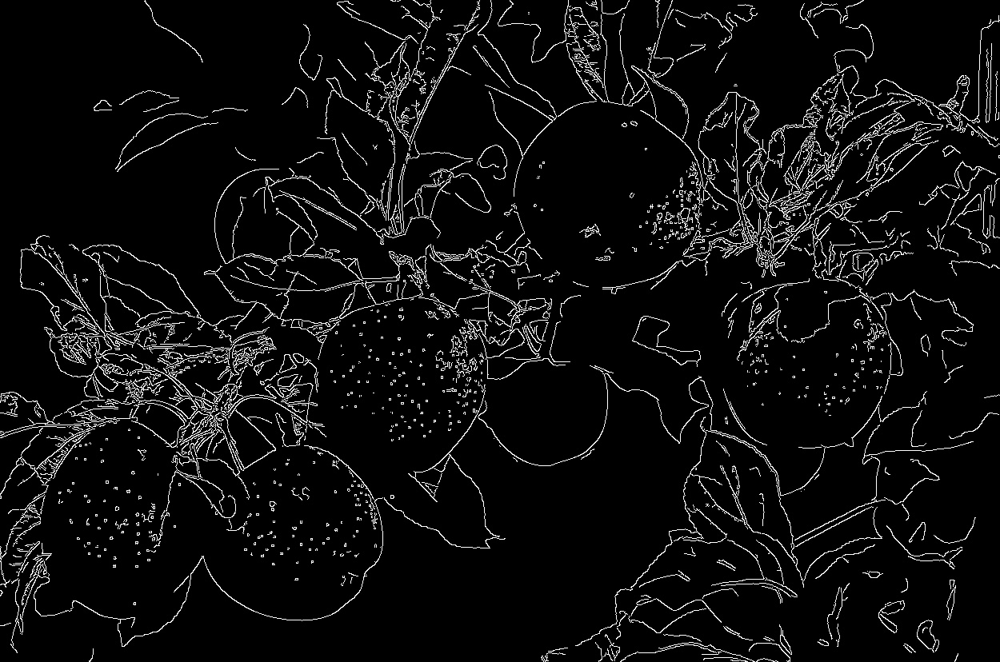 | 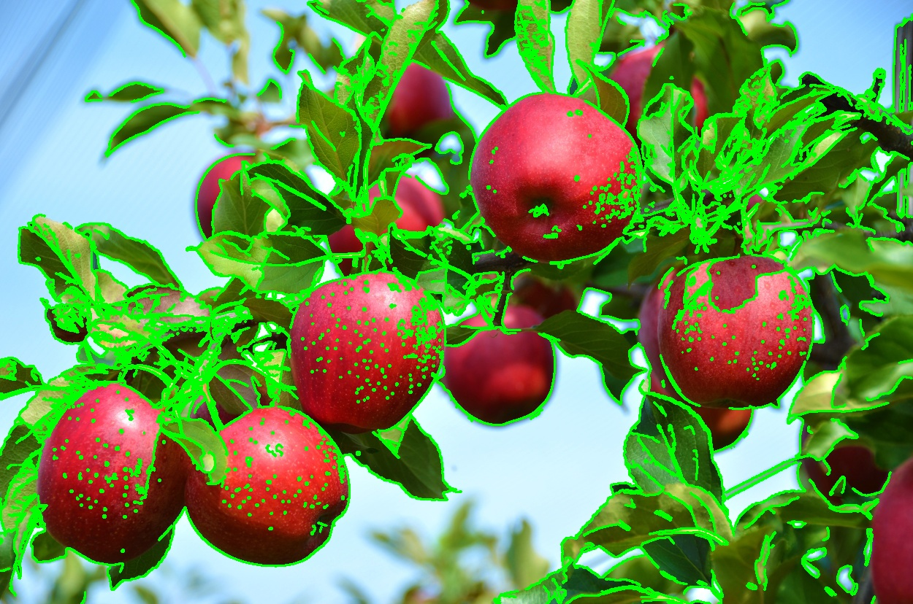 |

사과 검출 `ch4/4-4.py`. 검출 3개.

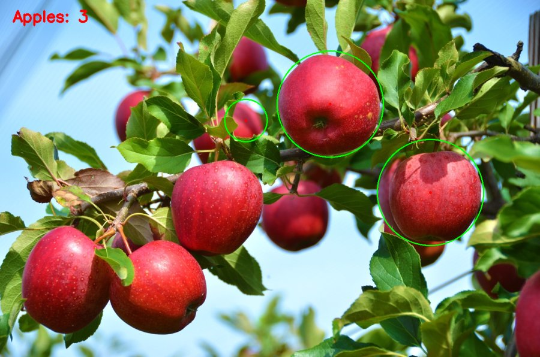

SIFT 매칭과 호모그래피 `ch5/5-4.py`.

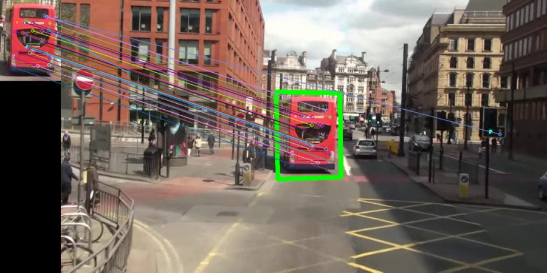

어린이보호구역 표지판 검출 `CPA_detection.py`. 도로 영상 1068프레임 중 3프레임 간격 356장 검사, 207장에서 검출.

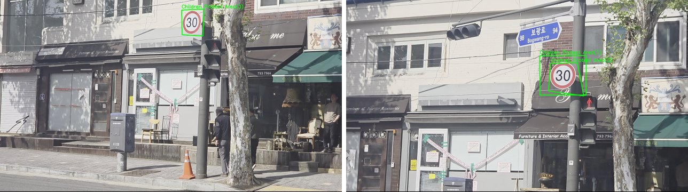

### 실행으로 확인한 문제와 처리

- `Calc.cpp`: 처음 구현은 `3 + 4 * 5 - 6`을 2로 계산하는 연산 순서 오류가 있어 배열 기반 두 단계 계산으로 수정. `3 + 4 * 5 - 6` 17, `2 * 3 * 4 + 1` 25, `8 / 2 * 3 - 1` 11 확인
- `ch4/4-4.py`: 사진 속 사과 10개 이상 중 3개만 검출. 조건별 탈락 원인은 미확인.
- `CPA_detection.py`: 정답 표시 데이터가 없어 검출 정확도는 미측정. 확인한 프레임에서는 속도 30 표지판에 사각형 표시.
- `Chap09/Prg9-15.cpp`: 행마다 `new int[i]`로 할당하고 `pascal[i][i]`까지 기록해 범위를 1칸 넘던 문제를 `new int[i + 1]`로 수정

---

## 빌드·실행 방법

### PRG_C

MSYS2 MinGW-w64 g++ 기준.

```bash
cd PRG_C/Chap05
g++ Prg5-11.cpp -o Prg5-11.exe
./Prg5-11.exe
```

한글 출력이 깨지면 PowerShell에서 `chcp 65001` 실행 후 실행.

파일을 읽는 예제는 데이터 파일이 있는 폴더에서 실행. `Prg5-7`·`Prg5-8`은 `numbers.dat`, `Prg8-2`는 `inFile.dat`, `Prg8-5`는 `numFile.dat`, `Prg8-14`는 `integerFile.dat`, `Prg9-18`은 `scores.dat` 사용.

분할 컴파일 예제:

```bash
cd PRG_C/Chap07
mingw32-make    # circle.cpp, app.cpp를 묶어 application 생성
g++ fraction.cpp app2.cpp -o application2.exe

cd ../HW6
g++ app.cpp product.cpp -o app.exe
```

단독 컴파일되지 않는 파일:

- `Chap07/Prg7-7~15`, `Chap08/Chap08/Prg8-4`, `Prg8-10~12`, `Chap09/Prg9-3`, `Prg9-7`, `Prg9-16~21`: 헤더·구현·애플리케이션 조각. 포함하는 헤더 파일이 같은 폴더에 없거나 `main`이 없는 파일.
- `Chap05/homework.cpp`, `Chap06/Prg.cpp`: 한 파일에 `main` 함수 2개.
- `cpp_class.cpp`: 빈 파일.

### PRG_CV

```bash
pip install opencv-contrib-python numpy matplotlib scikit-image PyQt5
cd PRG_CV/ch4
python 4-4.py
```

- 영상 파일을 상대 경로로 읽으므로 스크립트가 있는 폴더에서 실행.
- `ch3/3-9.py`는 폴더에 없는 `girl_laughing.png`를 읽으므로 그대로는 실행 불가.
- `6-6`, `6-7`의 유화 효과 `cv.xphoto`는 `opencv-contrib-python` 필요.
- 학습된 모델 `.h5`·`.weights`·`.pb`·`.onnx`, 데이터셋, 도로 영상 `.mp4`는 용량 문제로 저장소에서 제외. 실행 시 별도 준비 필요
- 7장 이후는 TensorFlow, MediaPipe, PixelLib, Transformers, PyTorch, trimesh, filterpy, keras_cv, scikit-learn 사용. 9·10장은 `yolov3.weights`, `yolov3.cfg`, 9장 분할 예제는 `.h5`, `.pb` 모델 파일 필요.

### PRG_MFC2

Visual Studio에서 각 프로젝트의 `.slnx` 열기 후 빌드. `WebCamViewer`는 `C:\opencv\build` 경로의 OpenCV 4.12 `opencv_world4120` 라이브러리를 참조하며, 실행 파일과 같은 폴더에 `yolo11l.onnx`, `coco.names` 필요.
